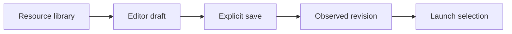
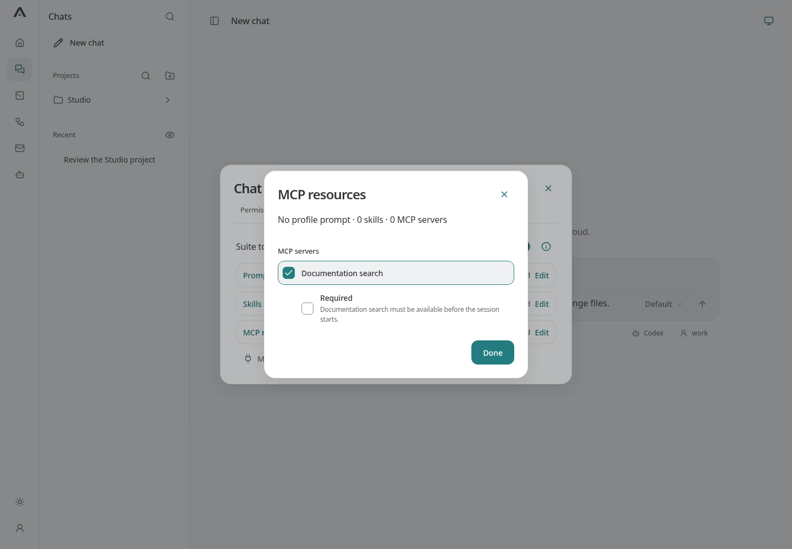

# Resource libraries and editors

Prompts, skills and MCP resources have distinct stores and editors. Launch selection captures resource choices; a library edit does not silently rewrite active work.

## State and boundaries

| Concern | Contract |
| --- | --- |
| Stores | Keep prompt, skill and MCP ownership distinct; use their clients and catalog identities. |
| Drafts | Protect unsaved or saving edits with the shared navigation guard. |
| Conflicts | Show save errors and revision conflicts; do not report success before the server confirms it. |
| Imports | Treat imported resource content as data; preview and selection are not execution. |

## Interface snapshot

Real Web interface with isolated fixture data, captured at 1440 × 1000 in the light theme. This shows interface structure, not backend readiness.

## Source and verification

[src/resources/sources.tsx](../../src/resources/sources.tsx), [src/resources/managed.tsx](../../src/resources/managed.tsx), [src/resources/editor/drafts.tsx](../../src/resources/editor/drafts.tsx), [src/prompts/PromptsPage.tsx](../../src/prompts/PromptsPage.tsx), [src/skills/SkillsPage.tsx](../../src/skills/SkillsPage.tsx).

Relevant checks: [prompts.spec.ts](../../tests/prompts.spec.ts), [resource-sources.spec.ts](../../tests/resource-sources.spec.ts), [mcp-managed.spec.ts](../../tests/mcp-managed.spec.ts). Fixture tests verify presentation and interaction; they do not establish live service availability.
