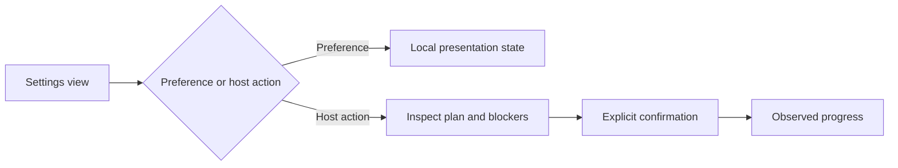

# Settings and reviewed updates

Settings combines local preferences with explicit host operations. Update presentation must preserve reviewed plans, blockers and restart consent.

## State and boundaries

| Concern | Contract |
| --- | --- |
| Preferences | Appearance state is local presentation; host settings have their own authority. |
| Updates | Workspace host updates differ from native Desktop/Client application updates. |
| Plans | A displayed plan is not consent to apply it. Preserve reviewed operation identity. |
| Destructive actions | Reset and removal flows must expose affected scope and wait for explicit action. |

## Source and verification

[src/settings/SettingsPage.tsx](../../src/settings/SettingsPage.tsx), [src/settings/UpdatesSettings.tsx](../../src/settings/UpdatesSettings.tsx), [src/settings/ResetSettings.tsx](../../src/settings/ResetSettings.tsx).

Relevant checks: [settings.spec.ts](../../tests/settings.spec.ts). Fixture tests verify presentation and interaction; they do not establish live service availability.
