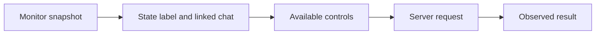

# Supervision

Supervision controls project monitor state into a conversation-linked view. The frontend contract must be distinguished from current Server execution support.

## State and boundaries

| Concern | Contract |
| --- | --- |
| Identity | Resolve the monitor-linked conversation; sort active and needs-input monitors consistently. |
| States | scheduled, running, waiting, needs_input, paused, completed and cancelled drive labels. |
| Availability | Retained command UI does not establish a functioning command backend; see implementation status. |

## Source and verification

[src/command/supervision.ts](../../src/command/supervision.ts), [src/command/SupervisionControls.tsx](../../src/command/SupervisionControls.tsx).

Relevant checks: [command.spec.ts](../../tests/command.spec.ts). Fixture tests verify presentation and interaction; they do not establish live service availability.
