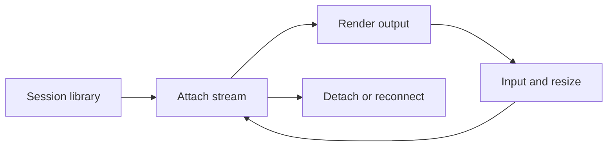
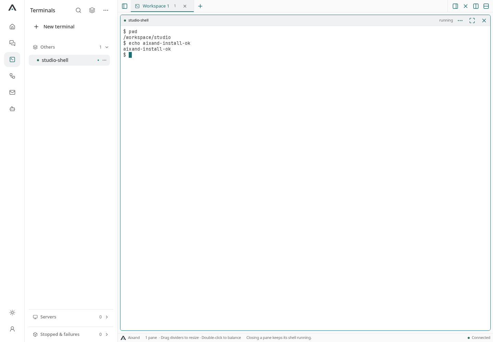

# Terminal sessions

Terminal panes attach to host-owned sessions and render streamed output through xterm. Pane visibility and socket connectivity are separate from process lifecycle.

## State and boundaries

| Concern | Contract |
| --- | --- |
| Session | Library and lifecycle models describe host sessions; closing a view must not imply killing a process. |
| Stream | Retain stream/session identity and offset rules in connection/runtime helpers. |
| Geometry | Fit and resize follow the visible pane; hidden panes must not force misleading dimensions. |
| Recovery | Make reconnect failures visible and clean up listeners/attachments. |

## Interface snapshot

Real Web interface with isolated fixture data, captured at 1440 × 1000 in the light theme. This shows interface structure, not backend readiness.

## Source and verification

[src/terminals/connection.ts](../../src/terminals/connection.ts), [src/terminals/pane-runtime.ts](../../src/terminals/pane-runtime.ts), [src/terminals/TerminalPane.tsx](../../src/terminals/TerminalPane.tsx), [src/terminals/TerminalLibrary.tsx](../../src/terminals/TerminalLibrary.tsx).

Relevant checks: [terminal-resize.spec.ts](../../tests/terminal-resize.spec.ts), [terminal-recovery.spec.ts](../../tests/terminal-recovery.spec.ts), [terminal-lifecycle.spec.ts](../../tests/terminal-lifecycle.spec.ts). Fixture tests verify presentation and interaction; they do not establish live service availability.
