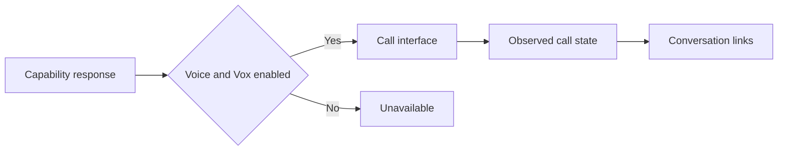

# Vox and voice

Vox presents call state and conversation links when voice capabilities are available. Media and call readiness remain separate from the visibility of the interface.

## State and boundaries

| Concern | Contract |
| --- | --- |
| Gating | Top-level capability defaults are false; Vox requires voice and vox to be true. |
| Polling | Capability fetch retries after failure and aborts on unmount. |
| Call state | Use Vox model and diagnostics for capability/media/call failures. |
| Evidence | A fixture call screen does not verify microphones, transport or provider access. |

## Source and verification

[src/capabilities.tsx](../../src/capabilities.tsx), [src/vox/Vox.tsx](../../src/vox/Vox.tsx), [src/vox/model.ts](../../src/vox/model.ts), [src/vox/diagnostics.ts](../../src/vox/diagnostics.ts).

Relevant checks: [voice.spec.ts](../../tests/voice.spec.ts), [vox-conversations.spec.ts](../../tests/vox-conversations.spec.ts). Fixture tests verify presentation and interaction; they do not establish live service availability.
