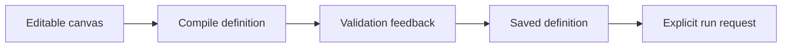
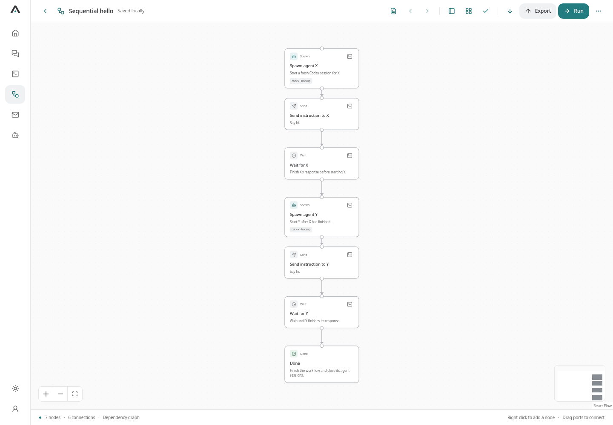

# Workflow builder

The builder translates canvas state into workflow definitions and validation feedback. A valid canvas is not evidence that an execution has completed.

## State and boundaries

| Concern | Contract |
| --- | --- |
| Graph | Use builder graph/model helpers for nodes, edges and selection. |
| Compilation | Keep compileCanvas and compile responsibilities visible; surface validation instead of submitting an invalid graph. |
| Execution | Inspect the selected run path and capabilities; native and retained workflow paths are not interchangeable. |

## Interface snapshot

Real Web interface with isolated fixture data, captured at 1440 × 1000 in the light theme. This shows interface structure, not backend readiness.

## Source and verification

[src/workflows/builder/WorkflowCanvas.tsx](../../src/workflows/builder/WorkflowCanvas.tsx), [src/workflows/builder/compileCanvas.ts](../../src/workflows/builder/compileCanvas.ts), [src/workflows/builder/compile.ts](../../src/workflows/builder/compile.ts).

Relevant checks: [workflow-builder.spec.ts](../../tests/workflow-builder.spec.ts), [workflow-library.spec.ts](../../tests/workflow-library.spec.ts). Fixture tests verify presentation and interaction; they do not establish live service availability.
