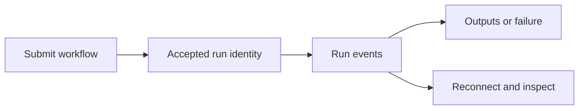

# Workflow runs

Run views correlate accepted work with run events, outputs and failures. Runner owns execution; Web owns the readable projection and explicit controls.

## State and boundaries

| Concern | Contract |
| --- | --- |
| Protocol | WorkflowConnection distinguishes ready, fatal, run-event and final result/failure messages. |
| Identity | Keep run identity and accepted definition associated; never attach a late event to a newer run. |
| Recovery | A closed socket is not a terminal run result. Reload retained evidence where supported. |
| Source status | Document the current Runner path separately from retained native workflow UI. |

## Source and verification

[src/workflows/client.ts](../../src/workflows/client.ts), [src/workflows/WorkflowRun.tsx](../../src/workflows/WorkflowRun.tsx), [src/workflows/builder/useNativeWorkflowRun.ts](../../src/workflows/builder/useNativeWorkflowRun.ts).

Relevant checks: [workflow-run.spec.ts](../../tests/workflow-run.spec.ts), [workflow-amendments.spec.ts](../../tests/workflow-amendments.spec.ts). Fixture tests verify presentation and interaction; they do not establish live service availability.
