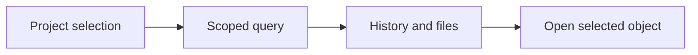
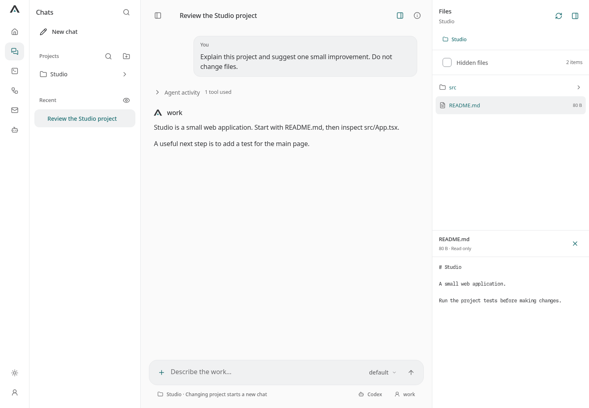

# Workspace, projects and search

Workspace pages combine project selection, history and search. Project-file previews are reads against the selected project, not an independent filesystem authority.

## State and boundaries

| Concern | Contract |
| --- | --- |
| Identity | Carry project ID and selected object identity through reads. |
| Files | Display supported content, truncation and read errors; do not assume every file is renderable. |
| Search | Navigate to the matching object without replacing unrelated drafts. |

## Interface snapshot

Real Web interface with isolated fixture data, captured at 1440 × 1000 in the light theme. This shows interface structure, not backend readiness.

## Source and verification

[src/workspace/Pages.tsx](../../src/workspace/Pages.tsx), [src/workspace/WorkspaceSearch.tsx](../../src/workspace/WorkspaceSearch.tsx), [src/workspace/model.ts](../../src/workspace/model.ts).

Relevant checks: [workspace.spec.ts](../../tests/workspace.spec.ts), [project-files.spec.ts](../../tests/project-files.spec.ts), [chat-search.spec.ts](../../tests/chat-search.spec.ts). Fixture tests verify presentation and interaction; they do not establish live service availability.
