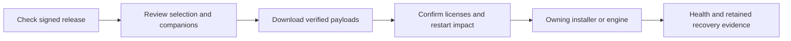
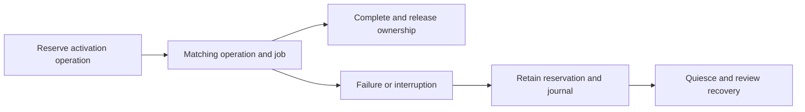

# Aixand installation updates

Application, runtime-component and product updates have separate owners. Provider CLIs keep their provider policy. Source development mode never downloads or installs application updates.

## User controls



| Concern | Contract |
| --- | --- |
| Connection window | Trusted Desktop updates/Client updates replace the local application after reviewed release and close/restart consent. Client never updates its connected Server. |
| Settings → Updates | Application, runtime-component and installed-tool updates on the packaged workspace host. Check all updates queries all three owners; Server application review can happen here. |
| Preferences | Component checks default to daily; automatic downloads are opt-in. Neither authorizes installation. |
| Authorization | Retain session, exact Origin and CSRF checks. Review selected components, required companions and complete restart impact. |
| Tools | Agent, Conversation, MCP, Prompt and Skill Manager; Undercurrent, Carrier, Runner and orchestration MCP. Show shared/private scope and workspace computer. |
| Ownership | Do not adopt unmanaged PATH commands. Recognize changed engine-owned shared tools only after canonical artifact and compatibility verification. |
| Undercurrent | Shared upgrades require its backup/maintenance procedure; normal tool updates do not stop unrelated UC homes. |
| Libraries | Update with their consuming applications, not as independent tools. |

Server component commands:

```sh
aixand-server update status
aixand-server update check
aixand-server update plan --select server
aixand-server update download --select server
aixand-server update install --select server
aixand-server update daily off
aixand-server update automatic-download on
aixand-server product-update check
aixand-server product-update plan --select agent-manager
aixand-server product-update download --select agent-manager
aixand-server product-update install --select agent-manager --restart-consent
```

| Concern | Contract |
| --- | --- |
| Whole package | aixand-server application-update status\|check\|download\|plan\|install replaces independent runtime selections with the package baseline. |
| Selection binding | Review names replaced components; retain exact previous selection and immutable payloads. Changed selection invalidates review before replacement/startup. |
| Licenses | Interactive installation shows licenses/restart impact. Automation supplies --accept-license SHA256; --yes never accepts licenses implicitly. |
| Active work | Component installs need --restart-consent when services restart. Agent work must finish or be explicitly stopped separately. |

## Release identity and trust

| Identity or feed | Contract |
| --- | --- |
| Package releaseSequence | Positive compiled-build ordering, independent of SemVer |
| Feed sequence | Independent metadata revision ordering; legacy artifacts without releaseSequence use this value |
| Renewal | Retains package identity/verified bytes, advances metadata and creates new immutable URL aliases |
| Installed inventory | Retains content hash; observed sequence cannot decrease or change content at an observed revision |
| Application feeds | Separate Desktop, Server and Client feeds; first protocol supports API protocol 1 and refuses incompatible releases |
| Desktop/Server URLs | https://downloads.aixand.org/aixand-desktop/latest.json and https://downloads.aixand.org/aixand-server/latest.json |
| Signed envelope | schema, keyId, exact UTF-8 JSON payload and base64 Ed25519 signature; trust only public keys bundled in update-config.json |
| Application payload | Dates, expiry ≤90 days, release sequence, notes and OS/architecture/format artifacts; signed hashes, sizes, runtime identities, product changes and license text |
| Download policy | Refuse redirects and external origins. Published paths are immutable, e.g. aixand-server/0.1.0-beta.r12/HASH-setup.exe; SemVer build metadata does not order releases |
| Component feed | Schema 2, /aixand-suite-components/ROLE/TARGET/latest.json; binds role, target and component identity |
| Component closure | Exact companion release hashes, not version labels; runtime-bound components also pin the application runtime build |
| Component activation | Verified immutable workspace objects selected without editing the sealed app. Other owners require native installer, product engine or consumer rebuild; generic runtime install refuses them |
| Product feed | Schema 1, product aixand-suite-products, /aixand-suite-products/TARGET/latest.json; validity ≤31 days |
| Product identity | Canonical archive/manifest SHA-256, release ID, inline licenses, exact companions and qualified Suite runtime-build hashes |
| Product engine | Owns stores, command conflicts, collection pins and active consumers. Use bundled engine, never downloaded bootstrap scripts |
| Selection | Immutable installer catalog is baseline; config/product-selection.json selects verified software/product-updates/objects. Repair uses selected artifacts |
| Compatibility | Native app review fingerprints product selection and refuses unqualified builds. A signed check may refresh compatibility evidence for unchanged software |

## Development and qualification scope

| Concern | Contract |
| --- | --- |
| Disabled by default | Checked-in [update configuration](../../../scripts/runtime/update-config.json) is disabled. This guide establishes no public feed/channel availability. |
| Release owner | Release supervisor owns preparation; documentation/source setup must not enable channels. |
| Qualification | [Component contract](../../../docs/reference/components.md) defines activation owners. Whole-runtime support does not qualify independent installed-component updates. |
| Evidence | Signing, native repair, rollback limits and target qualification require separate checks. |

## Installation and recovery

| Concern | Contract |
| --- | --- |
| Download | Resume with byte ranges; verify signed size and SHA-256 before activation. |
| Fresh plan | Bind installed build, release, shared-product state and active sessions. Refuse stale plans; preserve shared-product dependency/ownership checks. |
| Reinstall | First-party beta rebuilds use explicit engine reinstall after consent; never pretend to be a new immutable version. Provider software is unchanged. |
| Helper | Copy Node outside the replaceable app; stop owned workspace services; snapshot owned SQLite databases with WAL/SHM after shutdown; install, reinstall/verify product kit and restart previously running services. Preserve terminal command preference. |
| Windows helper | Temporary per-user scheduled task survives workspace Job Object shutdown; remove task on completion. Normal callers use a limited task. An already-admin Server retains privilege to read private files; normal updates request no elevation. |
| Platform activation | Windows Desktop: NSIS /UPDATE. macOS: verify/replace sealed app. Linux: owning DEB/RPM manager and OS authorization; never overwrite behind it. |
| Software backup | Server console setup retains previous runtime; Desktop retains backups on Windows/macOS. Linux recovery belongs to its package manager. |
| Recovery state | Workspace updates/server or Desktop native configuration updates directory; retain job state, supported software backup and SQLite snapshot inventory. Exclude provider account directories. |
| Interrupted work | Report interrupted transfers/helpers; inspect before retrying. Failed checks preserve last successful check time. |
| Stateful recovery | Never automatically restore databases or downgrade shared products after the new runtime has run. Failed health checks retain evidence. Stop installation, inspect snapshots and review repair against current schema. |
| Existing installs | Need one rebuilt installer to acquire updater support. |
| Product jobs | Snapshot owned workspace databases after shutdown and retain per-product reports; shared data outside the workspace is excluded. Failure retains activation ownership; never silently restart uncertain mixed state or downgrade shared data. |

## Activation ownership and interrupted locks



| Concern | Contract |
| --- | --- |
| Reservation | Native/component updates reserve one activation owner before handoff. Refuse ordinary lifecycle changes until it completes. |
| Worker identity | Match retained operation/job; stale jobs cannot replay replacement or overwrite a newer result. |
| Startup integrity | Recheck selected payload inventories; refuse corrupt code/assets without fallback. |
| Interrupted activation | Keep reservation and journals. Quiesce installation and inspect recorded operation, software selection and retained database snapshot. No automatic takeover/downgrade. |
| Short request locks | Publish complete owner records. Aged empty/truncated locks may recover; live/acquiring locks remain protected. |
| Arbitration failure | Death during short arbitration fails closed. After all callers are quiesced and no participant remains, reviewed recovery may remove only the empty `<lock>.arbitration` directory. |
| Preserve evidence | Keep updates/activation.json and journals. Removing an arbitration directory does not resolve activation. Native filesystem/scheduler crash behavior needs platform qualification. |

## Validation

```sh
node --test scripts/runtime/updates.test.mjs scripts/runtime/server-cli.test.mjs scripts/runtime/server-installer.test.mjs
cd apps/server && npx vitest run src/updates/updates.spec.ts
cd ../web && npx playwright test --config playwright.desktop.config.ts
npx playwright test --config playwright.settings.config.ts
```

Download Worker tests belong to sibling `aixand-installer`. Feed promotion still requires native installer/OS authorization and Windows/macOS/Linux upgrade tests; unit tests and browser fixtures do not substitute for them.
