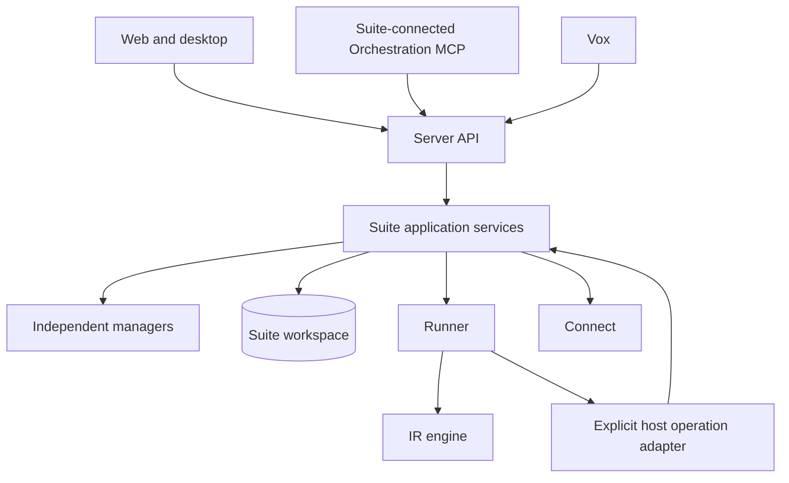

# Suite architecture

The accepted decisions and their rationale are recorded in
[ADR 0001: Suite composition](decisions/0001-suite-composition.md).
This overview tracks ownership and implementation progress.
[ADR 0002](decisions/0002-carrier-task-results.md) records MCP grouping and Carrier task results.

Aixand Suite composes independent managers into a workspace application.
The v0.1.0-beta provider scope is Codex and OpenCode. Provider capabilities
still determine which conversation, terminal, resource and permission operations
are available.

## Ownership

| Owner | Authoritative state and behavior |
| --- | --- |
| Suite Server | Projects, workspace organization, application preferences, manager references, application use cases and frontend events |
| Agent Manager | Provider software, authentication, native environments, profile aliases, native configuration, execution and continuation |
| Conversation Manager | Managed conversations, provider protocols, transcripts, settings, approvals, queues and worker lifecycle |
| Prompt Manager | Prompt content, composition, snapshots and package lifecycle |
| Skill Manager | Native skill content, validation, source workflows and export, using Prompt Manager's lifecycle contracts |
| MCP Manager | Server definitions, sources, installation generations, preparation and connector operations |
| Runner | Durable workflow submission, scheduling, checkpoints, cancellation and outcomes |
| IR | Workflow definitions, validation, expressions and execution semantics |
| Connect | Pairing, remote transport, file transfer and receiving companion |
| Vox | Audio transport, transcription, speech and voice interaction |
| Undercurrent | Native process/session supervision and terminal I/O |
| Carrier | Durable messages, inboxes, replies and acknowledgments |

Suite retains exact manager references and application associations. Manager-owned
content and lifecycle observations are obtained through public APIs. Cached UI
projections must not become another transcript, queue or lifecycle authority.

## Interaction

This diagram shows the intended application boundary. Current Server consumers
still use the active Orchestration MCP exporter described under qualification
limits; the diagram does not claim that extraction is complete.



The server's TypeScript transports and private Python workers together implement
the application backend. Transport handlers authenticate, validate the request
envelope, dispatch a use case and deliver results/events. Application services
coordinate public integrations and Suite persistence. Integrations translate
public manager contracts without duplicating their domain behavior.

A managed chat uses Conversation Manager. A native agent terminal uses Agent
Manager with Undercurrent. Shared project/environment associations do not make
these the same process or lifecycle. Reconnection retains exact identities;
unconfirmed operations are inspected without implicitly starting replacements.

Resource composition resolves selected content through its owning manager and
captures supported launch inputs and provenance. Retry uses the original captured
intent. Discoverable library content does not establish delivery support.

Orchestration MCP supports standalone operations over independent public APIs.
Its Suite-connected tools should call Suite application services for workspace
operations through Server's private authenticated interface. They must not
independently open Suite's database or reproduce Suite workspace policy. Web and
Vox use the same application operations. Initially, Python application services
remain inside the existing Server worker and use the existing private bridge.

Required beta acceptance covers local Codex/OpenCode administration, managed chats
and native terminals. Prompt/MCP delivery requires supported, verified adapters.
Advanced workflows, native skill delivery, remote chat and Vox require separate
qualification before becoming beta acceptance requirements.

Runner calls explicit host adapters for Suite effects. Workflow documents cannot
choose Suite sockets or credentials. Connect carries remote requests to a receiving
host that executes through its local supported integrations. Vox supplies audio
and voice interaction around application/conversation operations.

## Repository organization

The repository layout is:

```text
apps/server/                  application backend
apps/web/                     browser frontend
apps/desktop/                 Tauri shell
services/connect/             remote transport and companion
services/vox/                 voice subsystem
workflow/runner/              durable workflow service
workflow/ir/                  workflow model and engine
sdks/python/                  optional convenience composition SDK
mcps/orchestration/           MCP tools and standalone host
scripts/                      development, packaging and release tooling
```

Published package names are independent of source directory names.
[Dependency preparation and packaging](dependencies.md) use pinned published
manager, Carrier, Undercurrent and library inputs. Runner and orchestration MCP
are Suite-owned products; orchestration MCP is not part of Manager Suite's
published five-manager collection.
The Python SDK composes public Agent Manager, Carrier and Undercurrent APIs for
Python consumers. It is not a required intermediary for Suite, a workflow engine,
or the Python binding of IR.

## Current foundation and qualification limits

Local Codex/OpenCode onboarding, managed chat composition and native terminal
integration form the beta foundation. Provider capabilities still gate each
operation. This checkout does not establish full v0.4 orchestration qualification
or a public release.

Suite workspace operations still have consumers of the active
`orchestration_mcp.compat` exporter and services. This is an implementation boundary
to refactor, not a second compatibility distribution. Do not remove the exporter
without replacing its current Server consumers. See
[application composition](../apps/server/agent-bridge/application/README.md).

Connect, Vox, advanced workflows and native skill delivery need separate
qualification. Preserve captured operation IDs, exact environment/conversation
identities and receipts when inspecting or recovering uncertain work. Never
recover an uncertain launch by silently creating a replacement.

Component manifests and release tooling define source build boundaries. They do
not prove independent installed updates; see the [component contract](reference/components.md).

## Agents page integration

The [Agents integration contract](agent-integration.md) records the current page boundaries,
independent resource stores, explicit chat selections and skill-delivery limit.
