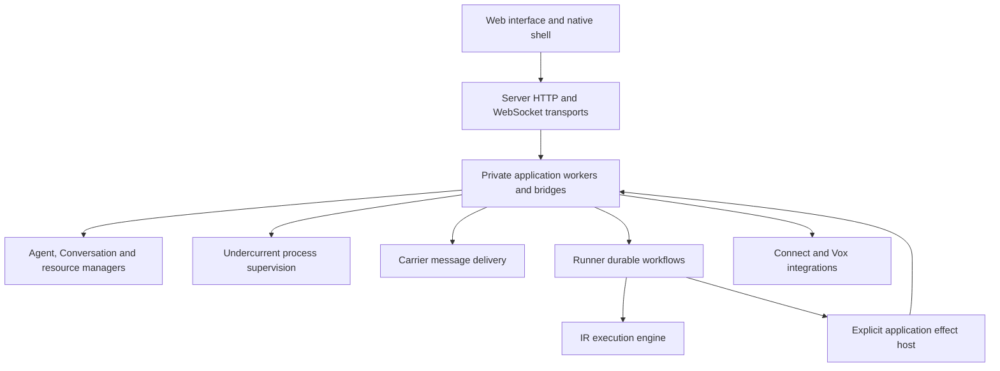

# Suite architecture

Suite combines independent managers, messaging, and process services into one
workspace. Execution belongs to the selected backend's computer.

- **Suite:** interface and local backend, with optional Server connections.
- **Client:** interface and native connection transport.
- **Server:** workspace backend without a desktop/browser frontend.

## Boundaries and ownership

This diagram shows runtime coordination, not package dependencies.

Server's TypeScript transports handle authenticated HTTP/WebSocket requests.
Private Python workers coordinate manager APIs and workspace state; Rust bridges
provide native integration. See [ownership](ownership.md) for each authority.

Server still consumes `orchestration_mcp.compat` services. Application extraction
is incomplete; there is no separate compatibility distribution.

Managed chats use Conversation Manager. Native terminals use Agent Manager and
Undercurrent. Runner schedules durable jobs; IR defines execution. The Python SDK
is optional.

## Further details

- [Execution and recovery](execution-and-recovery.md)
- [Security boundaries](security.md)
- [Component map](../README.md#find-a-component)
- [Compatibility](../reference/compatibility.md)
- [Application services](../../apps/server/agent-bridge/application/README.md)
- [Development integrations](../development/integrations.md)
