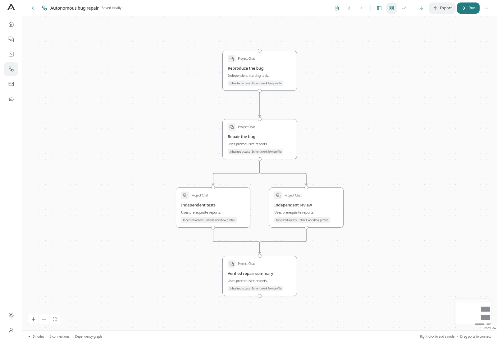

# Fix and verify a bug autonomously

A supervisor runs a repair workflow, checks its evidence, and delivers the result
without keeping your chat turn open.

Complete [preparation](prepare.md) and use a fresh sample. Enable workspace edits
and the required test commands through your existing access policy. Automatic
progress still stops for missing authorization, quota, or decisions outside the mandate.

## Send this prompt

```text
Create a persistent monitor for this sample's overdue-task bug. Save the full
mandate before dispatching work. Use the current project and a ready local native
Codex supervisor. Limits: 20 evaluations, 8 actions per evaluation, one repair attempt.

Autonomously submit this conversation workflow through Orchestration MCP:
- reproduce: inspect the existing tests; confirm the completed-task failure.
  Successful reproduction is a completed diagnostic task; setup errors are failures.
- repair: depends_on reproduce. Make the smallest fix; preserve existing tests.
- tests: depends_on repair. Independently run all tests and the demo; do not edit.
- review: depends_on repair. Inspect the diff for correctness and regressions;
  do not edit. A completed review must state whether the fix is acceptable.
- summary: depends_on tests and review. Combine the complete reports and record
  acceptance checks, changed paths, and unresolved findings. Do not edit.
Use summary as delivery_step. Use the captured execution context and stable
operation IDs. Require each child to submit its scoped task result.

The supervisor must inspect the canonical Runner result and actual evidence.
Success requires all tests passing, demo output only 'Write release notes',
and no unresolved blocking review findings. A completed stage alone is insufficient.
If the first repair is inadequate, report needs_input rather than repeating it.
Do not commit, push, install dependencies, or edit outside this project.

Retain exact workflow/task IDs. Checkpoint waiting and end each evaluation while
work runs; continue on its retained result. Put the final brief and evidence
references in checkpoint progress. Return the monitor link, then finish this turn.
```

## Check the result

Open the conversation's **Supervising** badge. Expect one monitor, one workflow,
and retained reports from the independent test and review stages.

Run `python -m unittest -v` and `python demo.py` yourself to confirm the result.
A **Needs you** state means the mandate needs attention, not that repair succeeded.



Illustrative draft in the real builder; not a recorded autonomous run.

Next: [Build a feature through parallel reviews](feature-pipeline.md).
