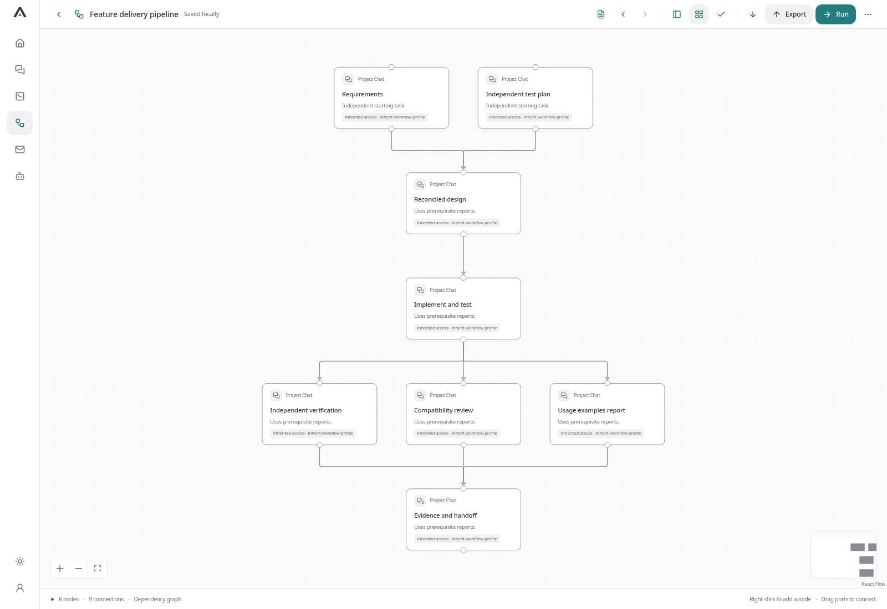

# Build a feature through parallel reviews

Use an eight-stage workflow to turn requirements into an implementation, independent
checks, and a handoff. Parallel stages inspect; only the implementation stage edits.

Complete [preparation](prepare.md), then [fix the sample bug](fix-and-review.md).
Use a disposable copy with workspace access. Keep a baseline diff before starting.

## Send this prompt

```text
Create a persistent supervisor for a feature in this task-list project.
Save the full mandate before dispatch. Limit it to 24 evaluations and 8 actions
per evaluation. Use the current project and local native Codex supervisor.

Feature: add list_tasks(tasks, include_done=False). Return unfinished tasks by
default, optionally include completed tasks, and sort by due date then task ID.
Return a new list without reordering the input. Keep existing functions compatible.

Use submit_conversation_workflow with these steps:
- requirements: inspect current behavior and define acceptance cases; read-only.
- test-plan: independently propose edge cases and regression checks; read-only.
- design: depends_on requirements and test-plan. Reconcile both reports into a
  small API/implementation plan; read-only.
- implement: depends_on design. Implement the function and meaningful tests.
  This is the only writer. Run the complete test suite.
- verify: depends_on implement. Run tests and independently check ordering,
  completion filtering, empty input, and input preservation; read-only.
- review: depends_on implement. Review compatibility and actual diff; read-only.
- documentation: depends_on implement. Draft usage examples in the report and
  check them against the code; do not edit files.
- handoff: depends_on verify, review, and documentation. Deliver the API example,
  verified test results, changed paths, and open findings; read-only.
Select handoff as delivery_step. Capture context and keep operation IDs stable.
Require scoped task reports and inspect the canonical Runner result.

Checkpoint waiting between results instead of polling. Complete only with evidence
for every acceptance case and no blocking findings; otherwise use needs_input.
Do not commit, push, add dependencies, or start a second writer. Deliver the final
brief through checkpoint progress. Return the monitor link and end this turn.
```

## Check the result

Inspect all eight stage reports. Confirm the two initial reviews run independently,
and the three final checks depend on implementation. Run the full test suite and
inspect that the new function preserves the input and existing behavior.



Illustrative draft in the real builder; not a recorded execution. The documentation
stage produces a report, so it cannot race with code edits.

Next: [Prepare a release decision](release-readiness.md).
