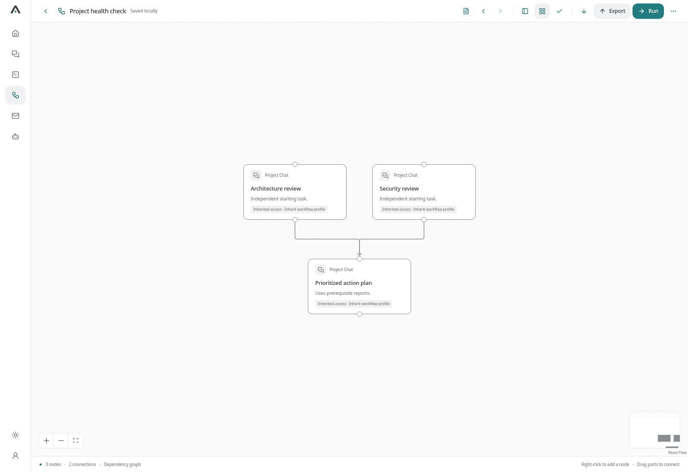

# Run a project health check

Run architecture and security reviews in parallel. Start planning only after both
reports succeed, using a Runner workflow submitted through Orchestration MCP.

## Before you start

Complete [example preparation](prepare.md), including workflow tool readiness.
Use a fresh sample and read-only access. Reviews can run commands if approved;
they must not install packages or modify files.

## Send this prompt

```text
Save this full mandate in a persistent monitor before dispatching. Use a ready
local native Codex supervisor with 16 evaluations and 8 actions per evaluation.
Use submit_conversation_workflow to run a read-only project health check.
First confirm Runner, delegation, and result-inspection capabilities are ready.
Use the supplied provider, immutable environment ID, and absolute workspace.

Submit these steps:
- architecture: inspect structure, maintainability, and test coverage.
- security: inspect input handling, dependencies, filesystem/network access,
  and credential handling. Report only evidence-backed risks.
- plan: depends_on architecture and security. Use both accepted reports to
  produce a prioritized action list with file paths, evidence, and verification.
Select plan as the delivery step. Tell each review task to use its scoped
result-submission tool. No project edits or package installation.

Keep the submission operation ID stable across retries. Retain the workflow ID;
after an uncertain response, inspect the existing submission instead of replacing it.
Checkpoint waiting and end each evaluation after dispatch. On workflow settlement,
use inspect_execution_workflow and get_execution_workflow_result to inspect the
canonical Runner result, or explain any failure/blocker.
Leave human approvals to me. Summarize both review results and the final plan;
do not treat workflow acceptance as completion or invent a Main inbox delivery.
Publish the final brief through checkpoint progress. Return the monitor link and
end this turn.
```

## See the dependency graph



This screenshot shows an agent-authored illustration saved in the real builder
with fixture authentication. It has not been executed. It illustrates the requested
dependencies; MCP submission does not automatically create this saved canvas.

## Check the result

- One workflow contains two independent reviews and a plan depending on both.
- The plan uses both reports. A failed prerequisite must not be treated as successful input.
- Runner's canonical result confirms the selected final step and prerequisite results.
- Findings cite actual files. No security findings is valid; do not require an invented vulnerability.
- Project files remain unchanged.

Inspect the existing workflow after reconnecting. Cancellation does not undo
completed work. Generic MCP workflows do not promise automatic Main inbox delivery;
the separate [Suite audit template](../guides/workflows.md) provides that application flow.

Next: [Fix a bug autonomously](autonomous-fix.md).

[Orchestration contracts](../../mcps/orchestration/docs/delegation-workflows.md)
