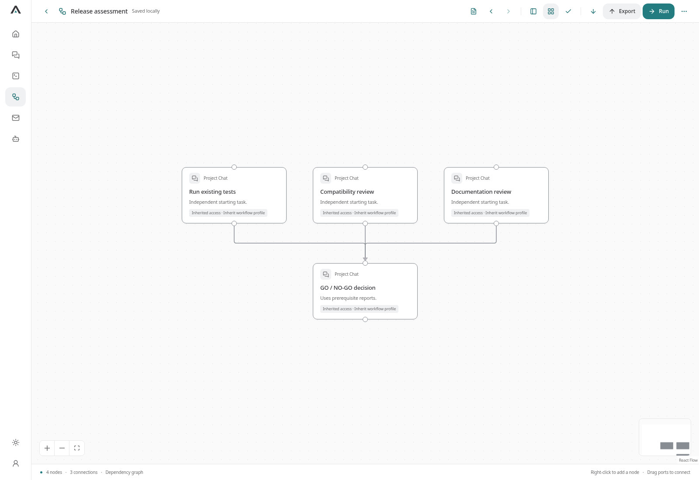

# Prepare a release decision

Collect independent test, compatibility, and documentation checks before deciding
whether a change is ready. This workflow produces a decision; it does not publish.

Use a project with proposed changes and documented test/build commands. You can
use the [fixed sample](fix-and-review.md). Complete [workflow preparation](prepare.md)
and select read-only access with permission to run existing checks.

## Send this prompt

```text
Create a persistent monitor to assess this project's current changes for release.
Record the exact project, baseline revision/diff, and full mandate before starting.
If the comparison baseline is unclear, ask me before dispatching.
Use a local native Codex supervisor, at most 16 evaluations and 8 actions each.

Submit a read-only conversation workflow:
- tests: run documented checks; report command, exit status, coverage, and skips.
- compatibility: inspect changed public behavior, inputs, and backwards compatibility.
- docs: compare setup/usage instructions with the code; verify examples where possible.
- decision: depends_on tests, compatibility, and docs. Read all reports and produce
  GO or NO-GO, blockers, evidence, and draft release notes grounded in the diff.
Use decision as delivery_step. Do not change versions, edit files, install packages,
commit, tag, push, or deploy. Missing checks are unknowns, never assumed passes.

Require scoped task reports. Inspect the canonical Runner result using the same
workflow ID. Keep mutation operation IDs stable. The supervisor must checkpoint
and end its turn while waiting, then resume from retained observations.
A completed assessment may correctly conclude NO-GO. Put that decision and evidence
in final checkpoint progress. Return the monitor link and finish this turn.
```

## Check the result

Expect three independent reports and one combined decision. A passing workflow
means the assessment finished; it does not imply GO or that a release was published.

For the untouched sample, the known failing test must appear as a blocker.
Review the proposed release notes against the actual diff before using them.



Illustrative draft in the real builder; not a recorded release assessment.

Next: [Supervise an existing implementation](supervise-work.md).
