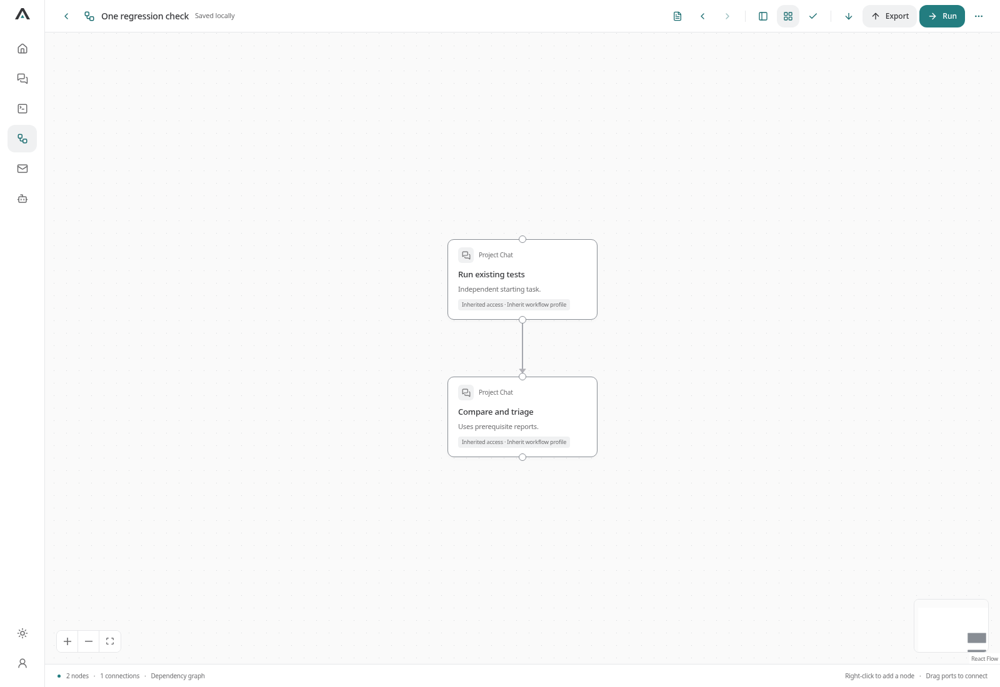

# Watch regressions for a fixed period

Have a supervisor repeat a small verification workflow while another conversation
changes the project. Report problems without editing or restarting the worker.

Use a project with existing, safe test commands and a ready native Codex supervisor.
Complete [preparation](prepare.md). For the sample, use `python -m unittest -v`.
Checks observe current files; concurrent edits can produce temporary failures.

## Send this prompt

```text
Create a persistent read-only monitor for this project's tests for the next hour.
Save this entire mandate before dispatch. Resolve and record the exact project,
existing test command, and a deadline one hour from now.
Limits: 16 evaluations, 8 actions per evaluation, at most four check runs.

Run a conversation workflow now, then at 15-minute intervals until the deadline
or run limit, whichever comes first. Never overlap check runs:
- test: run the existing test command and capture complete failure evidence.
- triage: depends_on test. Explain failures using changed files and prior reports.
  Report whether the failure is new, unchanged, or uncertain. Do not edit files.
Use triage as delivery_step. Each check gets a new workflow identity; retries of
that same check reuse its operation ID. Retain all workflow IDs in monitor memory.
If the test process fails, report that accurately as a completed diagnostic task;
execution/tool failures must remain failed and must not be invented as test results.

Use timer watches and checkpoint waiting between checks. No sleeping model turns,
polling loops, package installs, fixes, commits, or external notifications.
Inspect canonical workflow results and full reports. Surface new regressions in
this originating conversation, then continue within the saved limits.
If checks cannot run, use needs_input. At the deadline/run limit, remove remaining
watches and deliver a final evidence summary through checkpoint progress.
Return the monitor link and end this turn.
```

## Check the result

Inspect the monitor's timer watches, deadline, run count, and distinct workflow IDs.
The untouched sample should consistently report the intentional completed-task bug;
repeated occurrences are not separate new regressions.

Stop the monitor when finished. Existing checks may continue after supervision stops;
inspect and cancel their exact workflow if necessary.



Illustrative draft of one check. The supervisor owns recurrence; a Runner DAG does
not supply the timer loop. The backend must remain running while the client is closed.
