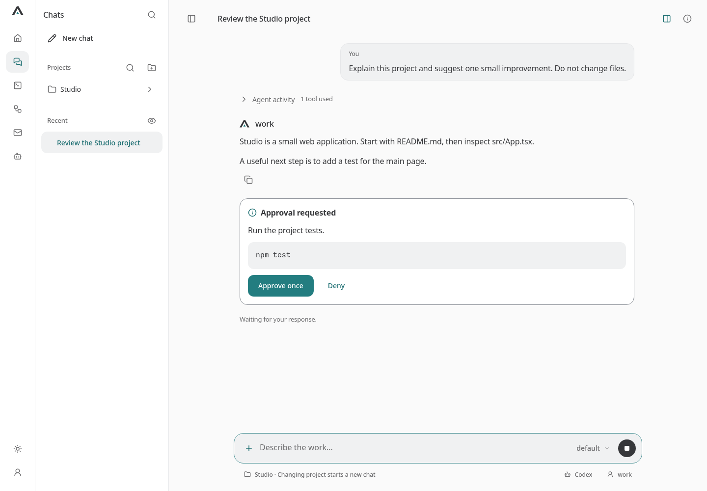

# Manage a conversation

Open a saved chat from history to continue the same conversation. Start a new chat
to change its provider or initial resource selection.

## Answer approvals and questions

Read the proposed command, files, or requested access. Choose **Approve once** or
**Deny**. For a question, select/type the answer and submit it with **Send answers**.

## Send follow-ups

When the provider supports it, **Model → Chat settings → Conversation → Message timing**
controls delivery:

| Choice | Behavior |
| --- | --- |
| Add to current turn | Steer the work already running |
| Send after this turn | Queue the message until the current turn ends |

Use the queue controls to edit/remove messages that have not been delivered.
Type `/` in the composer for commands advertised by the active session.

## Stop, reconnect, or delete

- **Stop** interrupts the active turn. Check its resulting state; earlier edits are not rolled back.
- After a disconnect, reopen the saved chat. Do not resend a message whose outcome is unknown.
- Use the conversation's deletion action and review its scope. Deleting history and stopping execution are separate operations.

Read the completed response and test evidence before treating the task as done.
For delegated work, inspect the accepted report and delivery state too.

Next: [Projects and files](projects.md). See [troubleshooting](troubleshooting.md)
if the conversation cannot reconnect.
