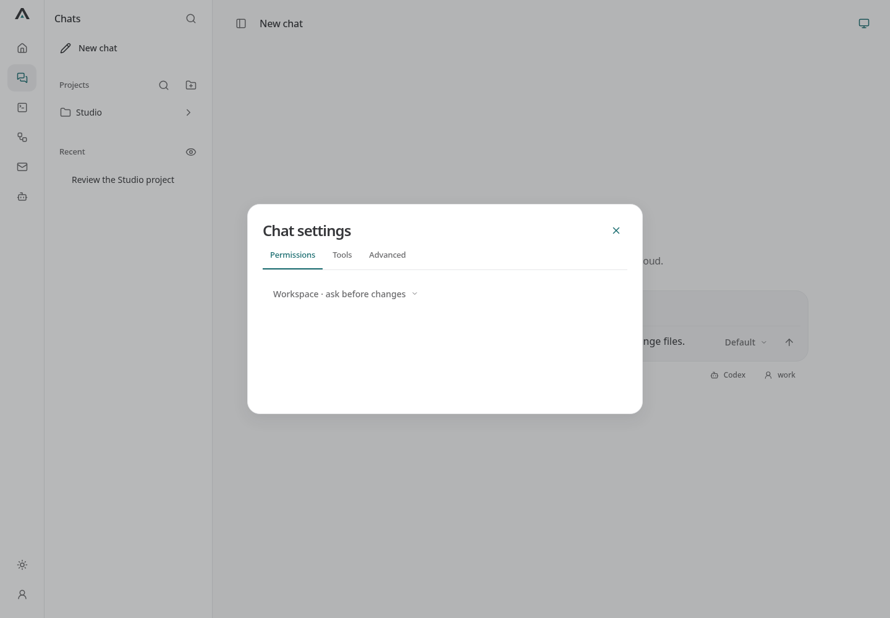
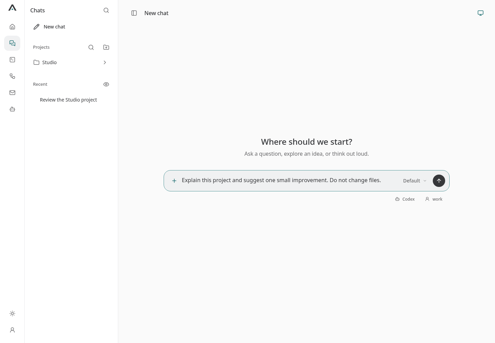
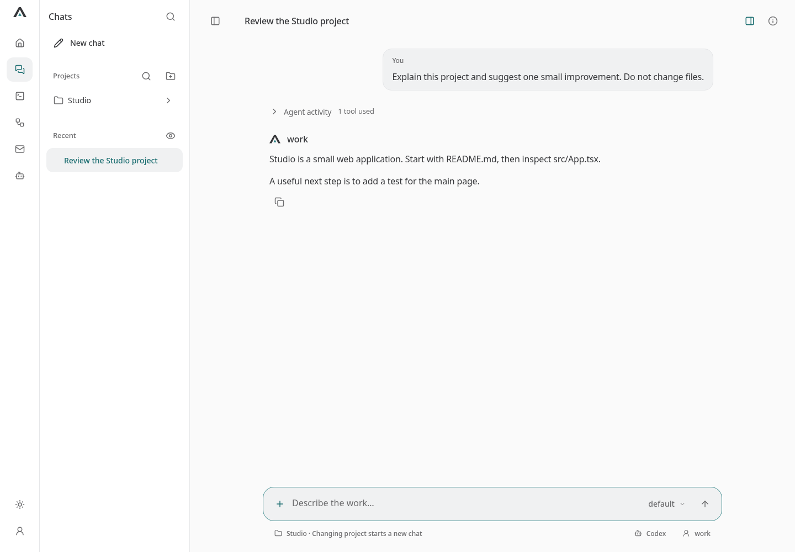

# Start a conversation

Complete [onboarding](../getting-started/first-workspace.md) first. You need a
configured provider and a project on the workspace host.

## Choose the conversation settings

1. Open **Chat** and select **New chat**. If history is hidden, open **Show chat history** first.
2. Select **Project** in the composer and choose your folder.
3. Select **Provider**, then **Profile**. Choose your configured profile, or Auto where supported.
4. Open **Model** and select a supported model or keep the provider default.
5. From the model picker, open **Chat settings → Permissions** and review access.

| Access | Use it for |
| --- | --- |
| Read only | Inspection without project edits |
| Workspace access | Work within the project, with the displayed approval policy |
| Full access | Work without the sandbox's normal restrictions; review before selecting |

Available settings depend on the provider/backend. Prompt wording does not change
permissions. Select [instructions and tools](resources.md) before sending if needed.

## Send a task

Describe the task, desired result, and any constraints. For example:

> Explain this project's structure and suggest one small improvement. Do not change files.

Send the message. Review the response, expandable tool activity, and any requested
approval. Provider requests can consume quota.

Next: [Manage the conversation](conversation-controls.md).
