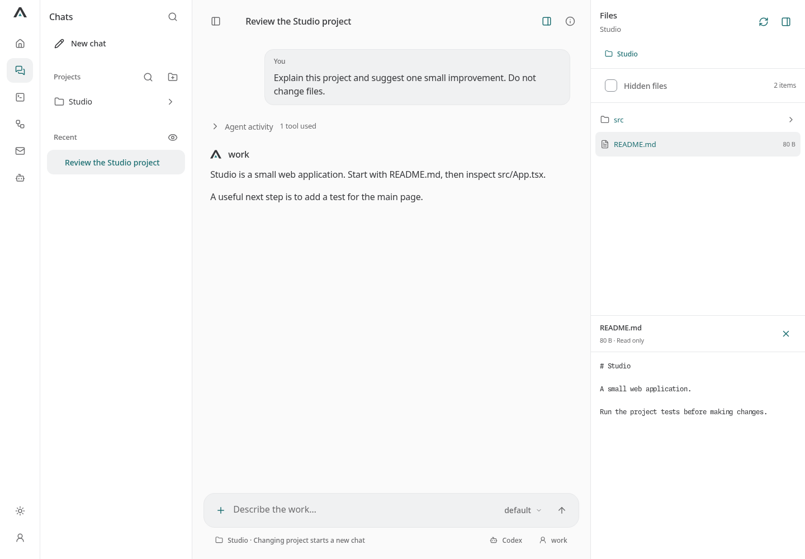

# Work with projects and files

Projects associate conversations with folders on the workspace host. Client does
not upload its desktop folders when you select a Server project.

## Add or switch projects

1. In Chat, open the **Project** picker and choose **New project…**, or use **New project** in history.
2. Enter the project name and existing host-side path.
3. Select **Create project**, then choose that project for a new conversation.

Registration does not clone/copy files or require Git. Pick another project before
starting a separate task; a saved conversation retains its original context.

## Browse files

1. Select the project and open **Show project files**.
2. Open a folder, then a file to preview its contents.
3. Use folder breadcrumbs to return; **Hidden files** includes hidden entries.
4. Use **Load more files** if the directory has more results.

The file pane opens beside the conversation on desktop and as a drawer on smaller
screens. Reading a preview does not itself send that file to the agent. Use the
composer's `@` file picker when you want to reference project content.

If the directory is unavailable, restore its path and retry. Removing a project
registration does not delete its files. [Connect](../../services/connect/README.md#copy-a-project-to-a-device)
handles copies to paired devices separately.

Next: [Native terminals](terminals.md).
