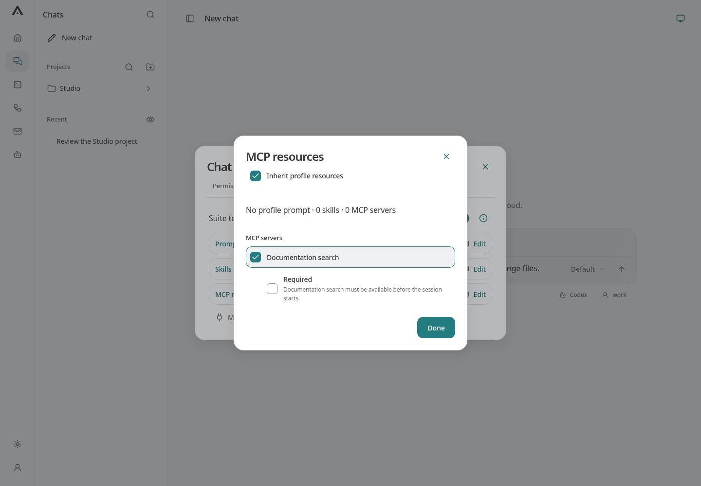

# Use prompts, skills, and MCP tools

Use the resource libraries to create/import reusable content. Select supported
resources when starting a chat.

| Resource | Purpose |
| --- | --- |
| Prompts/instructions | Reusable guidance for an agent |
| Skills | Packaged instructions/files discovered through a supported provider path |
| MCP tools | Tools supplied by configured MCP servers |

## Prepare a resource

1. Open **Prompts**, **Skills**, or the MCP library in Agents.
2. Create/import the content using its library controls.
3. Review pending publisher changes before accepting them.
4. For MCP, complete preparation and check server readiness.

## Select resources for a new chat

1. Open **New chat** and choose its provider/profile/project.
2. Open **Model → Chat settings → Tools**.
3. Open **Prompts**, **Skills**, or **MCP resources**. Select supported entries, then choose **Done**.
4. Review unavailable/required-resource errors before sending.

**Suite tools** exposes supported Suite conversation/workflow operations. It is
separate from selecting another MCP server. Some backends do not support it.

Existing chats keep captured resource selections. Changing library content does
not update a running chat. Skill library support does not guarantee native skill
delivery to managed chats; use the displayed provider support/delivery status.
Resources and preparation belong to the execution machine.

Next: [Workflows](workflows.md). Exact preparation/delivery contracts are in
[Server resources](../../apps/server/docs/suite-resources.md).
