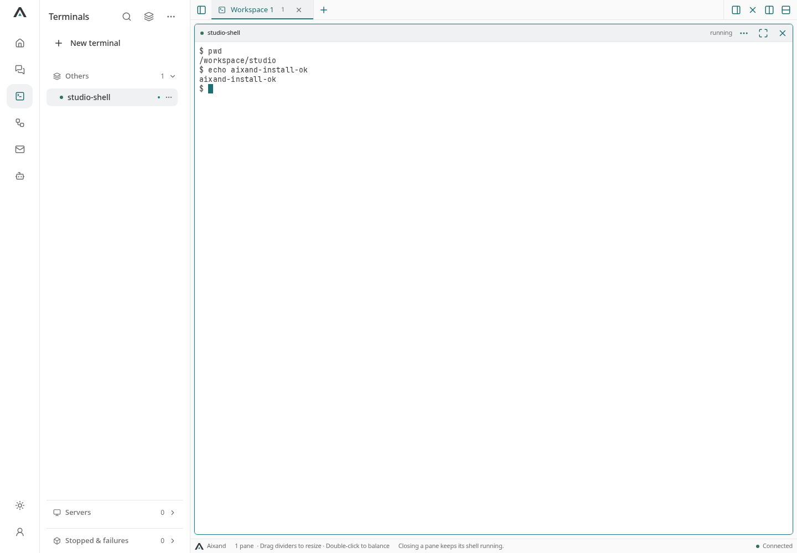

# Use native terminals

Open **Terminals** to work with shells on the workspace host. Native terminals
have a separate lifecycle from managed conversations.

## Create or open a terminal

1. Select **New terminal**, enter a **Session name**, and optionally choose a group.
2. Select **Create terminal**. A group can supply saved shell/directory defaults.
3. Check the directory: `pwd` in a POSIX shell, or `Get-Location` in PowerShell.
4. Run a command, for example:

   ```sh
   echo aixand-install-ok
   ```

Expect `aixand-install-ok`. To reopen an existing session, expand its list section
and select its name.



## Arrange and stop sessions

Use pane controls to split the workspace. **Close pane** removes that view;
it does not mean the shell stopped. Reopen the retained session to return.

| Action | Effect |
| --- | --- |
| `exit` | End your current shell |
| Stop gracefully | Request a normal stop, then apply the configured timeout |
| Force stop | Terminate immediately |
| Restart | Start a new process using saved configuration |
| Remove | Delete a finished session and retained output |

Use the session's lifecycle controls and review any shared-worker impact before
stopping/restarting it. After a disconnect, inspect the retained session before
creating a replacement.

Next: [Resources](resources.md).
