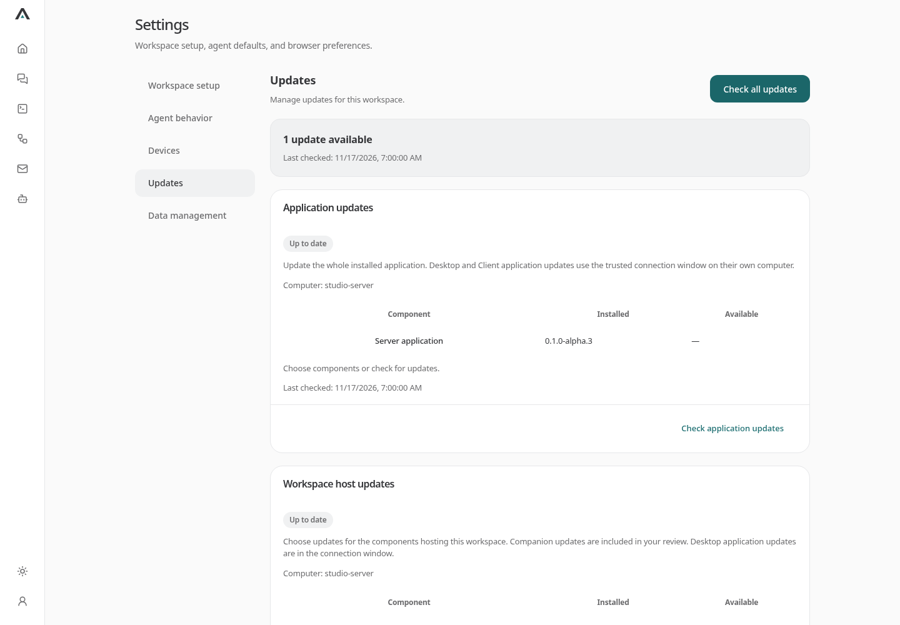
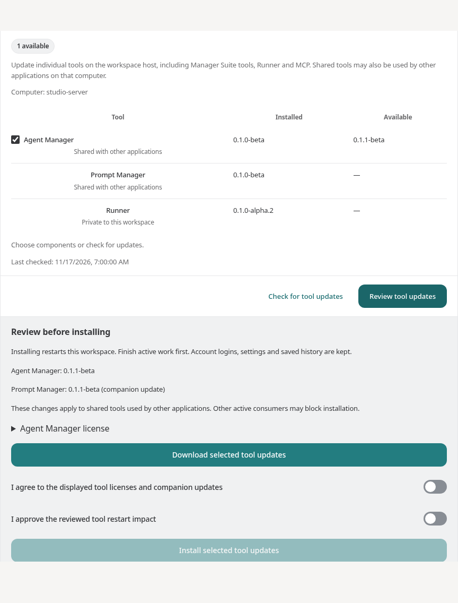

# Install updates

Finish active work before installing updates. With Client, check which computer
owns the update: your desktop application or the connected Server.

## Choose what to update

| Update | Where to open it |
| --- | --- |
| Suite or Client application | Application updates in the native connection window |
| Server application | **Settings → Updates → Application updates** |
| Workspace components | **Settings → Updates → Workspace host updates** |
| Managers, Runner, MCP, and other tools | **Settings → Updates → Installed tool updates** |

Updating Client does not update Server. Shared tool changes can affect other
applications on the workspace host.

Manager tool updates replace the installed commands and their private runtimes.
Use a workspace host update to change the manager SDKs bundled with Server.
For a shared Undercurrent installation, follow its maintenance procedure to stop
the daemon and back up its data before replacing the software. Review the new
tool selection in Suite when a compatible update is available.

## Check and review

1. Open **Settings → Updates** and select **Check all updates**.
2. Check the displayed computer, installed versions, and available versions.
3. Select the components/tools you want to update.
4. Choose **Review update**, **Review tool updates**, or **Review application update**.
5. Read companion changes, licenses, blockers, and restart impact.

Screenshots use fixture data. The displayed versions are examples, not release
announcements.

## Download and install

1. Select the review's **Download** action and wait for completion.
2. Open the review again; downloading closes the previous review.
3. Accept the displayed licenses/companion changes and approve the restart impact.
4. Select the enabled **Install** action. Finish active work first and complete any OS authorization.

For Suite/Client application updates, use the native connection window's check,
download, and review controls, then confirm installation/restart there. On Windows,
keep the owning user signed in during installation.

## Verify the result

Reopen the application/workspace, check its installed versions, and repeat a small
conversation or terminal task. Review any listed completed/failed components;
a successful download is not an installed update.

| Status/problem | Next action |
| --- | --- |
| Unavailable | Read the reason; source builds or disabled feeds may use another update route |
| Blocked | Finish active work or resolve the listed companion/ownership requirement, then review again |
| Changed/stale plan | Fetch a fresh review; do not install the old selection |
| Recovery required | Preserve the operation/recovery files and inspect host diagnostics before another installation |

Automatic downloads do not authorize installation. Configure daily checks and
automatic downloads under **Update preferences**.

Alpha.1/alpha.2 installations need an installer upgrade first. See
[update recovery details](../../apps/web/docs/updates.md#installation-and-recovery)
or [troubleshooting](troubleshooting.md) if installation fails.

Next: [Troubleshooting](troubleshooting.md).
