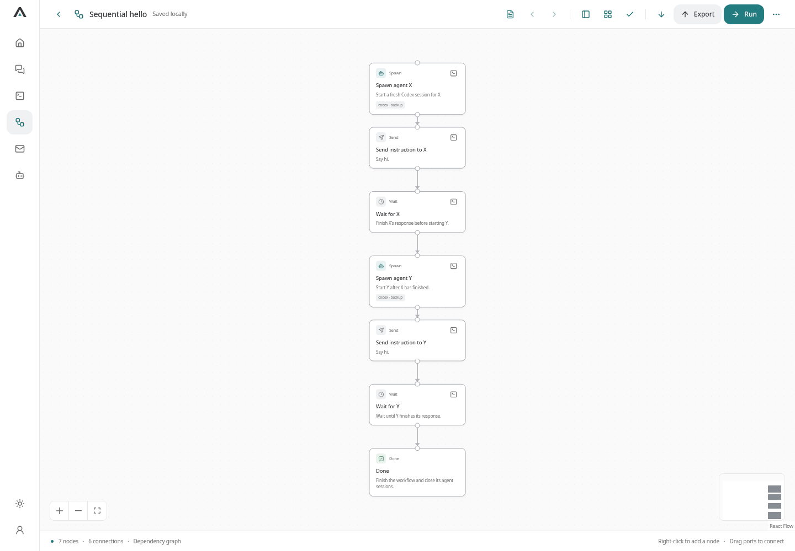

# Run a workflow

Use workflows for several tasks with dependencies. You need a configured project,
provider, and compatible Runner/effect host. A live run can consume provider quota.

## Create and review a workflow

1. Open **Workflows → New workflow**.
2. Choose a template and name it. For a composed review, choose **Project audit → main inbox**.
3. Select **Create workflow**.
4. Select nodes to review/edit their instructions and settings. Connect required report dependencies before running.

The audit template runs architecture/security reviews, combines their reports into
a plan, and delivers it to Main inbox. Other templates provide different starting
points. For a provider-free test, use the [Runner verifier](examples.md#run-a-workflow-without-a-provider).

The screenshot shows the separate **Sequential hello** example, not the audit template.

## Start and inspect a run

1. Select **Run** and choose the project/controller.
2. Review profile selection and access permissions, then choose **Start run**.
3. In **Workflows**, filter to **Runs** and open the accepted run.
4. Inspect stages, open their chats for pending input, and check the final result/delivery receipt.

Acceptance is not completion. Read each report and its test evidence; completed
execution does not mean every check passed.

## Change or recover work

Saving a definition changes future runs. Applying edits to a run changes pending
work only; started steps keep their accepted configuration. Pause upcoming steps
while reviewing changes.

After reconnecting, open the existing run and reconcile uncertain progress before
submitting another. Cancellation does not undo completed effects.

Next: [Maintain your workspace](maintenance.md).

[Workflow reference](../../apps/server/docs/integrations/native-workflows.md) ·
[Execution and recovery](../architecture/execution-and-recovery.md)
