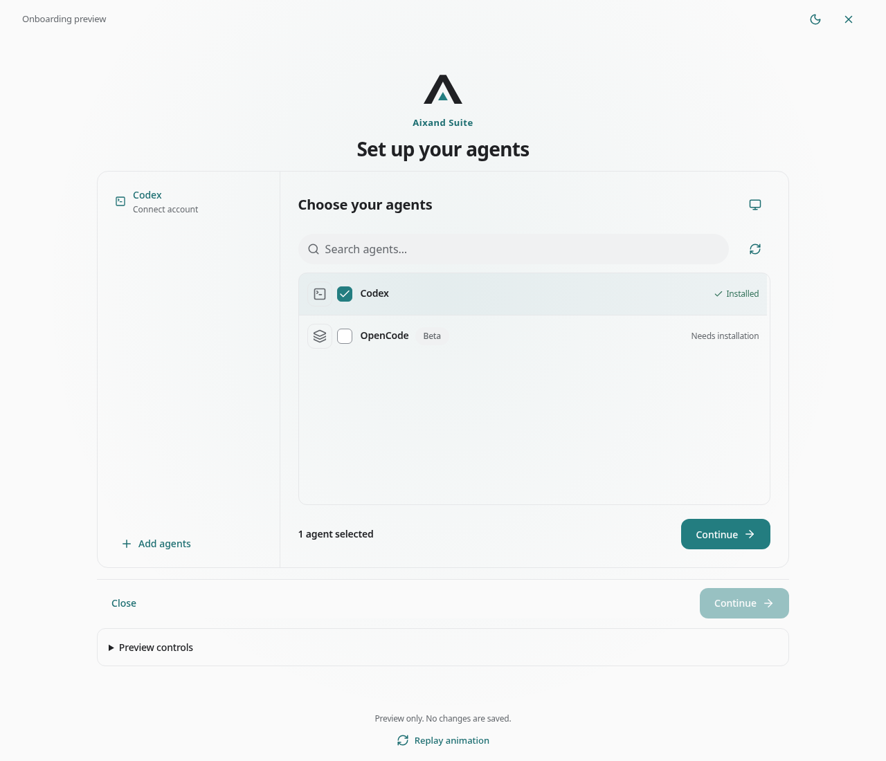

# Choose providers

On **Set up your agents**, select **Codex**, **OpenCode**, or both, then choose
**Continue**. You must select at least one provider to continue.

These providers run on the workspace host. With Client, that is Server rather
than your desktop. Setup checks the host's software and available installation
methods.

Next: [Install provider software](install-providers.md).
