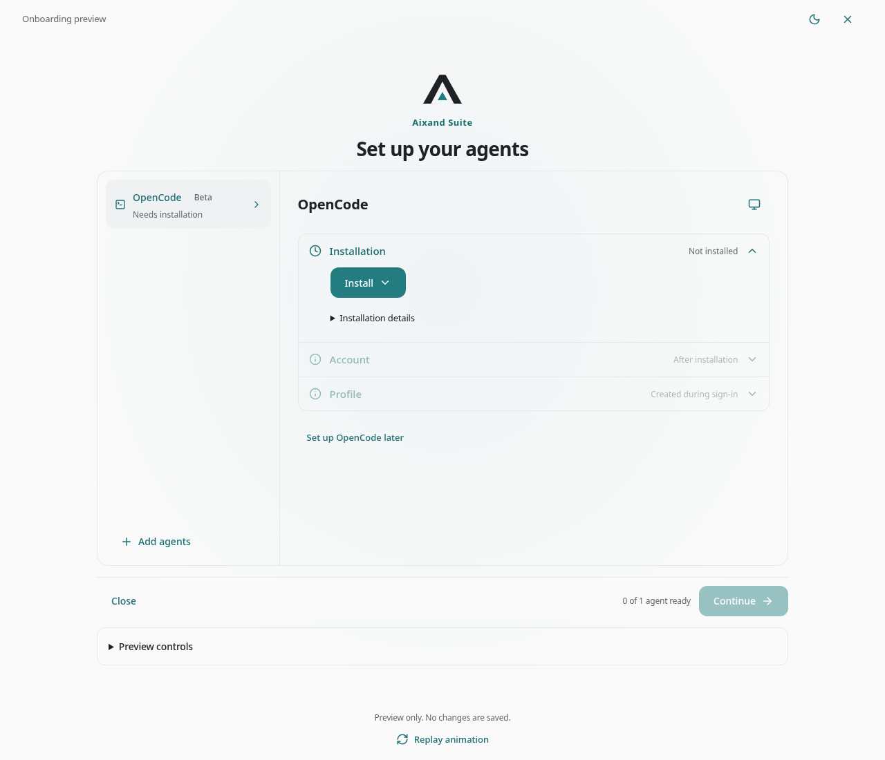

# Install provider software

Setup checks whether each selected provider is installed and ready.

- **Already installed:** continue with the detected installation.
- **Missing:** open **Install Codex** or **Install OpenCode** and choose an available installation method.
- **Install automatically:** follow progress and any requested terminal input.
- **Manual installation:** follow the displayed host-specific instructions, then refresh detection.

Methods depend on the workspace host and provider. Complete any required chat
support shown by setup before continuing.

If an operation is pending or failed, inspect its progress/error before retrying.
Do not start another installation just because the interface disconnected.

Next: [Create a profile and sign in](profiles-sign-in.md).
