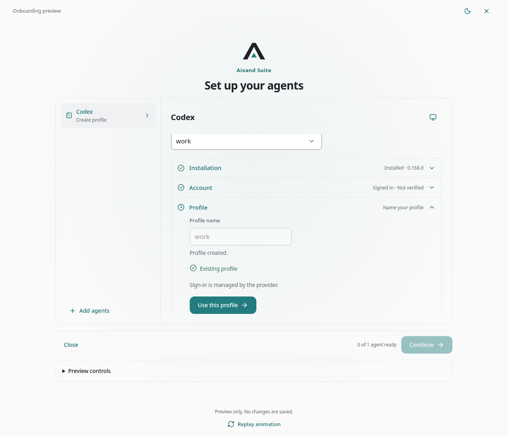

# Create a profile and sign in

A profile names the provider environment you will select for chats, such as
`work` or `personal`.

## Codex

1. Enter a **Profile name**.
2. Choose a supported **Sign-in method**: Browser or Device code.
3. Select **Create profile and sign in**.
4. Complete the provider's instructions in its sign-in terminal/browser. Enter credentials there, not in chat.
5. When sign-in finishes, choose **Use this profile**.

## OpenCode

After installation, choose **Sign in to a provider**, then create the profile and
complete native sign-in. Alternatively, choose **Continue without signing in**
for available free models, then **Create profile without signing in**.

## Confirm the profile

Review the selected profile and choose **Use this profile**. Repeat for any other
selected provider, then choose **Continue** at the bottom to reach projects.

A successful login does not guarantee model entitlement or remaining quota.
[Your first chat](finish.md) checks actual access. If sign-in fails, inspect the
existing operation and retry it rather than creating another profile.

Next: [Add projects](projects.md).

## Default instructions

Create reusable instructions in **Prompts**, then choose a saved prompt under
**Settings → Agent behavior → Global instructions**. These defaults apply to new
Codex and OpenCode chats using the same Suite state store.

In a profile's settings, **Profile instructions** can inherit global instructions,
append a prompt, replace global instructions, or turn these defaults off. Assignments
follow the profile when it is renamed. Prompt inputs are JSON objects. Leave the
optional pinned revision empty to use the accepted version for each new chat;
provide a managed state revision digest to keep a specific version.

At chat launch, **Prompts** shows the effective defaults and allows an explicit
replacement or **Off for this chat**. Configured defaults must render successfully
before startup. Existing chats and startup retries retain their captured content,
even after a prompt or assignment changes. Conversation information shows the
captured instruction layers and prompt revisions.

These settings apply to Suite chats. Native terminal instructions remain managed
by each provider. Turning Suite defaults off does not remove workspace instruction
files or Suite's operational tool instructions.
