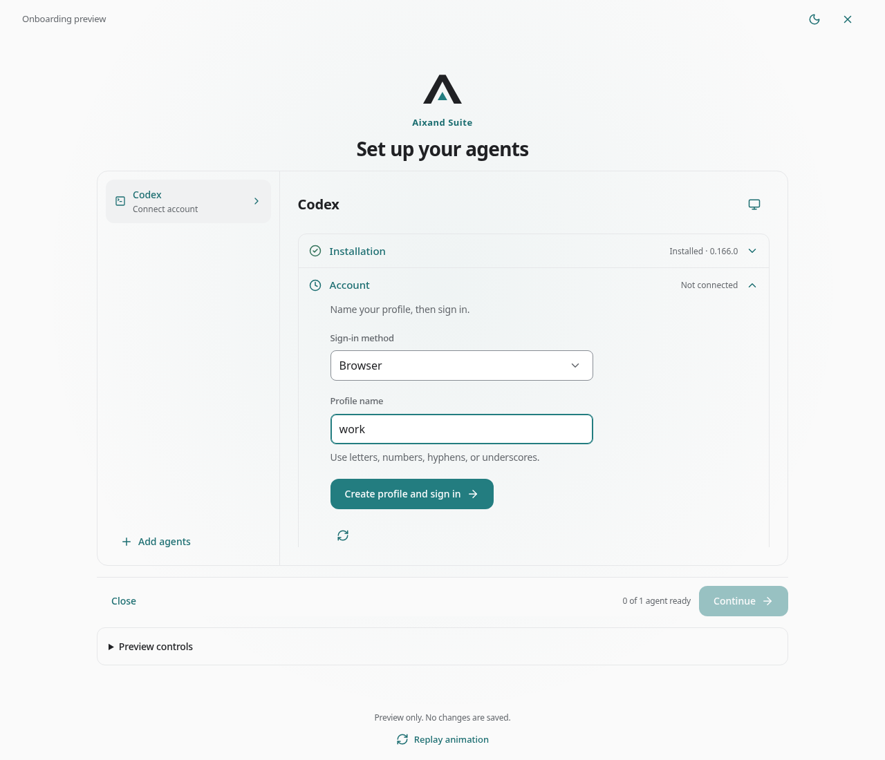

# Create a profile and sign in

A profile names the provider environment you will select for chats, such as
`work` or `personal`.

## Codex

1. Enter a **Profile name**.
2. Choose a supported **Sign-in method**: Browser or Device code.
3. Select **Create profile and sign in**.
4. Complete the provider's instructions in its sign-in terminal/browser. Enter credentials there, not in chat.
5. When sign-in finishes, choose **Use this profile**.

## OpenCode

After installation, choose **Sign in to a provider**, then create the profile and
complete native sign-in. Alternatively, choose **Continue without signing in**
for available free models, then **Create profile without signing in**.

## Confirm the profile

Review the selected profile and choose **Use this profile**. Repeat for any other
selected provider, then choose **Continue** at the bottom to reach projects.

A successful login does not guarantee model entitlement or remaining quota.
[Your first chat](finish.md) checks actual access. If sign-in fails, inspect the
existing operation and retry it rather than creating another profile.

Next: [Add projects](projects.md).
