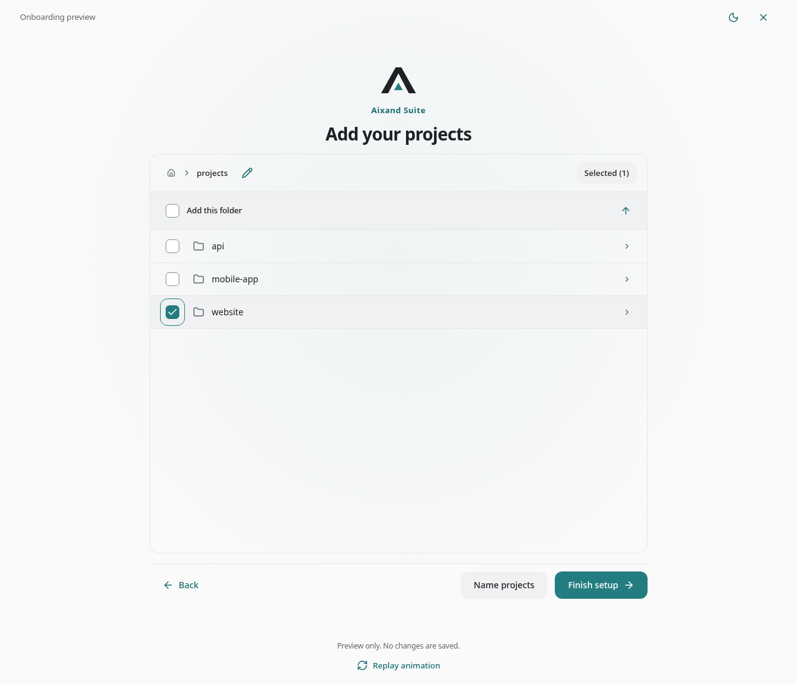

# Add projects during onboarding

On **Add your projects**:

1. Browse to the folder containing your projects.
2. Select the folders you want to include.
3. Open **Selected** to review paths and rename entries if needed.
4. Choose **Finish setup**. With nothing selected, use **Skip for now** to add projects later.

Paths refer to the workspace host. Client does not upload your desktop folders
when you select a Server project. Registration does not copy files or require Git.

Next: [Finish onboarding and check a chat](finish.md).
