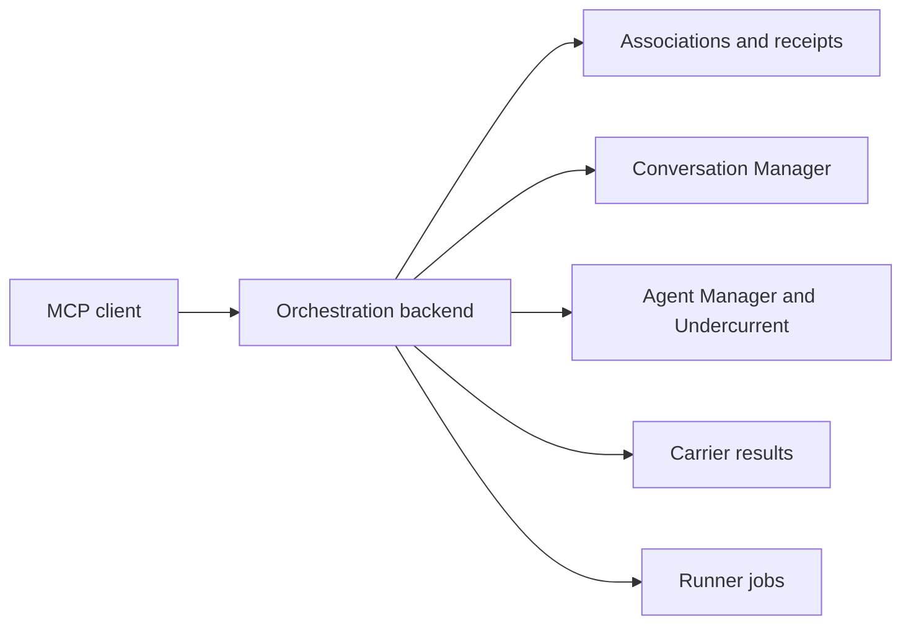

# Understand Orchestration MCP

Orchestration MCP exposes scoped tools over public manager APIs and retains execution associations, mutation receipts, delegated assignments and accepted task results. It can run independently, connect to a persistent local host, or forward an explicitly captured Suite contract. It does not own provider protocols, terminal emulation, message queues or workflow scheduling.

## Reading paths

| Task | Read in order |
| --- | --- |
| Install and connect | [Package installation and first stdio connection](../README.md#installation), [CLI configuration](reference/tool-groups.md#cli-configuration-and-retry-identity) |
| Understand tool availability | [Composition](architecture/composition.md), [tool groups](reference/tool-groups.md), [implementation status](implementation-status.md) |
| Change execution behavior | [Identity and ownership](architecture/identity.md), [receipts](lifecycles/receipts.md), [conversation and terminal operations](lifecycles/executions.md) |
| Change delegated work | [Delegation and workflows](delegation-workflows.md), [Carrier acceptance](integrations/carrier.md), [Runner effects](integrations/runner.md) |
| Change access or captured resources | [Security boundaries](architecture/security.md), [resource capture](integrations/resources.md) |
| Develop or verify | [Development](development.md), [source and checks](development/source-map.md) |

An accepted launch, a finished turn, a published report and a host-accepted result are distinct observations. None verifies the truth of an agent's claims. Read the canonical result and the relevant receipt before deciding what completed.

[Package overview](../README.md) · [Package metadata](../pyproject.toml)
