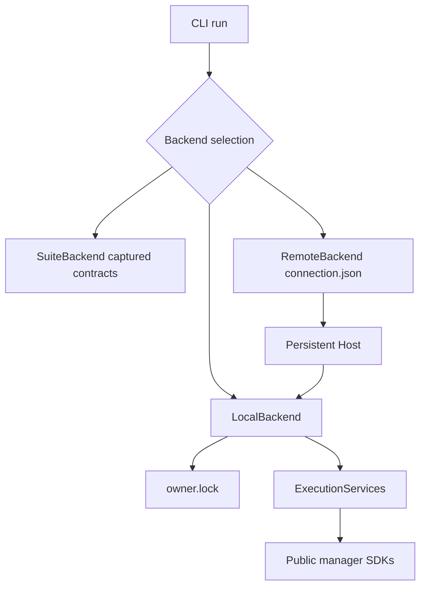

# Processes and composition

The CLI chooses a backend before serving newline-framed MCP. `--suite required` requires a private context; `auto` uses one if configured. Otherwise a configured or existing standalone connection descriptor wins, then a new local backend is constructed. `host` always runs the standalone owner and rejects `--suite required`.

| Layer | Responsibility | Boundary |
| --- | --- | --- |
| `cli.serve` | Initialize, freeze advertised tools for this connection, validate tool membership, serialize results | 1 MiB frames; supported MCP versions are explicit in source |
| `LocalBackend` | Group/capability filtering, lazy integration loading, project injection | Does not create Suite project state |
| `Host` / `RemoteBackend` | Persist work beyond client connections; private authenticated local transport | One owner per home; reconnect to the socket rather than competing owners |
| `ExecutionServices` | Receipts, execution references, manager routing | Attaches recorded conversations rather than launching replacements |
| `SuiteBackend` / `Adapter` | Forward a captured contract to an application endpoint | Captured contracts and application authorization remain authoritative |
| `publisher` | Capture deterministic executable adapters into MCP Manager | Publishing a definition is distinct from user acceptance |

The host keeps `connection.json` and `orchestration.sock` under its home. A disconnected client does not erase receipts. Backend close disconnects cached conversation handles and closes borrowed runtime connections; explicit close/stop tools control work lifecycle. Host startup also starts delegated report reconciliation and, when enabled and available, the Runner effect socket.

## Captured adapter publication

`publisher.publish` defaults to publisher ID `orchestration`; callers can supply a different publisher ID. A definition capture is not user acceptance or proof that a running application has updated its captured contract.

`contract.py` canonicalizes JSON and computes digests. `publisher.bundle` captures adapter code, contracts and local transport dependencies in a deterministic zip. `publish` compares definition versions, increments upstream revisions only for changed definitions and tolerates concurrent registration only when versions match. `accepted` checks the accepted artifact location and digest before use.

[backend.py](../../src/orchestration_mcp/backend.py), [cli.py](../../src/orchestration_mcp/cli.py), [broker.py](../../src/orchestration_mcp/broker.py), [publisher.py](../../src/orchestration_mcp/publisher.py), [transport.py](../../src/orchestration_mcp/transport.py).

Checks: [host isolation](../../tests/test_host.py), [standalone](../../tests/test_standalone.py), [bundle wire](../../tests/test_bundle_wire.py), [catalog round trips](../../tests/test_bundle_catalog.py).
