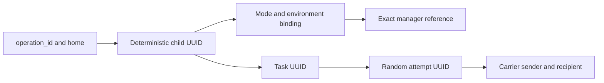

# Execution identity and state ownership

A profile label is a selection input, not a durable execution identity. Conversation launches require an exact `environment_id` and retain the selected agent reference. Terminal launches resolve a profile once before the first await, pass its immutable Target to Agent Manager, and reject an optional expected environment ID if the alias has rebound.

| Record | Owner | Invariant |
| --- | --- | --- |
| `execution_bindings` | Orchestration | Mode, provider, environment and exact SDK reference; wrong-mode operations conflict |
| `execution_operations` | Orchestration | Unique operation ID and exact tool/argument intent |
| `delegated_tasks` | Orchestration | Task/attempt, exact execution/turn, report acceptance and resource snapshot |
| `execution_workflows` | Orchestration | Immutable plan, Runner key/job and step-to-task associations |
| Transcript, turn, approvals, queue | Conversation Manager | Read through public client APIs; no duplicate delivery queue |
| Native process and terminal bytes | Agent Manager / Undercurrent | Retained reference selects the same execution |
| Jobs and dependency scheduling | Runner | Orchestration implements effects, not a second scheduler |
| Addressed publication and ACK | Carrier | Orchestration commits acceptance before acknowledgment |
| Project registry and application scope | Injecting application | Standalone project tools are unavailable without injection |

The local database is `execution-associations.sqlite3` under the resolved orchestration home. The home participates in deterministic UUID generation: changing it is not a migration. Listing retained associations does not establish that their processes are running. A binding without a reference remains unconfirmed and refuses normal execution operations.

`recorded_delegated_tasks` is a bounded read-only reader for up to 100 already-authorized IDs. It opens an existing database read-only and never reconciles Carrier, acknowledges messages or starts a host. Application callers must authorize IDs before invoking it.

[executions.py](../../src/orchestration_mcp/executions.py), [delegations.py](../../src/orchestration_mcp/delegations.py), [workflows.py](../../src/orchestration_mcp/workflows.py).

Checks: [execution groups](../../tests/test_execution_groups.py), [rebound terminal alias](../../tests/test_delegations.py), [sign-in handover](../../tests/test_signin_handover.py).
