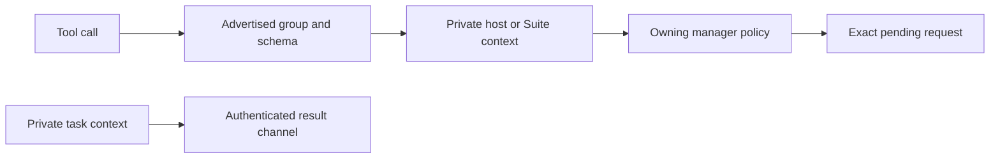

# Permissions and approval boundaries

Tool visibility narrows available operations; it does not grant permission to approve child requests or override the provider sandbox. Settings are passed through the owning manager contract. Workflow names and instructions do not imply permission presets. Pending approval/question responses require an exact conversation request ID and the adapter's advertised response shape.

| Boundary | Enforced behavior | Limit |
| --- | --- | --- |
| Local groups | Unknown groups rejected; unavailable tools fail before dispatch | Installed modules do not prove provider readiness |
| Host | Private regular descriptor, token comparison, private socket, home lock | Local OS authority still matters |
| Suite adapter | Private context, protocol, token, context ref, group and contract digest sent to broker | Application must enforce captured authorization |
| Delegated child | Reserved result server exposes only submission; task/attempt/routing cannot be overridden | Accepted shape and identity do not verify report truth |
| Resource capture | Explicit selections and bounded snapshots | Does not infer broader filesystem/network access |
| Sign-in | Durable environment-scoped gate with exact operation ownership | Never terminate a changed or unconfirmed owner |

## Sign-in handover and process policy

`SigninHandover` records new launch admission transactionally with its environment gate. Preflight lets existing delegated work finish and create legitimate children; sealing blocks all new launches. It inspects parent/child activity, approvals, queues, goals and background activity before sealing exact workers. Missing capabilities, unconfirmed startup, active tasks, changed owners and unsupported shared servers block retirement. Lost prepare replies retain the exact worker for later cancellation. Release requires the same gate operation and does not release another maintenance owner.

`CodexServerSettings` persists `separate`/`shared` with optimistic revision checks; default is separate. New launches capture the policy, retries keep it. Shared mode is reported unsupported on Windows by this settings API. These coordination classes are application-facing helpers, not additional standalone MCP groups.

Diagnostics retain only exception class and bounded basename/function/line frames, with private files and a 100-file retention cap. They exclude exception messages, locals and source text; recording failure never replaces the original operation result.

[signin.py](../../src/orchestration_mcp/signin.py), [codex_servers.py](../../src/orchestration_mcp/codex_servers.py), [diagnostics.py](../../src/orchestration_mcp/services/diagnostics.py), [transport.py](../../src/orchestration_mcp/transport.py).

Checks: [handover race and ownership cases](../../tests/test_signin_handover.py), [settings revisions](../../tests/test_codex_server_settings.py), [host authentication](../../tests/test_host.py).
