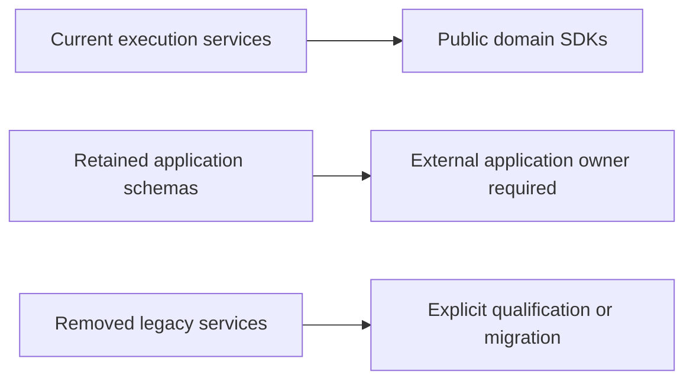

# Implementation status and legacy gaps

The current package implements standalone public-manager execution and authenticated delegated reporting. Retained application schemas and old instructions must be interpreted against actual shipped service modules and the connected application's captured contract.

| Area | Current implementation | Gap / interpretation |
| --- | --- | --- |
| Execution groups | Public conversation/native SDK dispatch, durable associations and operation receipts | Live provider readiness is separate |
| Delegation | Carrier assignment, exact attempt correlation, durable acceptance/ACK recovery | Correctness of report claims still requires review |
| Runner | Conversation-only DAG effects and canonical Runner result | Terminal/mixed steps, advanced graph amendments and automatic application delivery need extended contracts/qualification |
| Resources | Prompt capture and qualified managed stdio MCP snapshots | Frozen skills, recipe installation and transient MCP credential startup unsupported |
| Projects | SDK-free schemas and injection point | No local registry service or Suite workspace database |
| Monitors / command workflows | Exported application contracts | No standalone monitor/controller implementation here |
| Legacy services | `services` contains only diagnostics and package initializer | No former chats, project, workflow, controller or workspace service stack |
| Voice | `NoVoice` explicit unsupported start/stop | Application integration required |
| Shared Codex | Persisted server policy and exact-worker reconnect helper | Windows shared policy unsupported by settings API |

The dependency-boundary test explicitly prohibits importing `server_manager` and asserts absence of `compat.py`, `state.py`, `host.py`, `controllers.py` and `project_tools.py`. Do not document those removed modules as implementation owners. The standalone broker is `broker.py`.

The generic fallback MCP instruction string in `cli.py` still mentions `get_chat_status` and automatic application workflow reports. That prose is not evidence that those tools/services exist locally. Likewise the retained application's workflow JSON-final protocol does not replace `submit_task_result` for standalone delegation. Verify advertised tool contracts and owning application code before relying on either path.

This documentation is based on source inspection and documentation checks; it does not qualify paid/live providers, Windows execution or missing legacy application services.

[boundary assertions](../tests/test_dependency_boundaries.py), [CLI instructions](../src/orchestration_mcp/cli.py), [voice hook](../src/orchestration_mcp/hooks.py), [retained package overview](../README.md).
