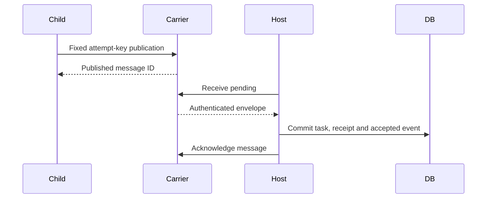

# Carrier publication and result acceptance

Each task attempt gets separate authenticated sender and receiver identities. Preparation uses Carrier's public local administration API with explicit `CARRIER_DATABASE`, then verifies both addresses against the service at `CARRIER_URL`. Channel preparation failure occurs before execution launch. A successful child submission means Carrier stored a message; host acceptance is a separate durable transaction.

| Contract | Value / invariant |
| --- | --- |
| Body schema | `orchestration-mcp/task-result-1` |
| Identity | Exact task and attempt UUIDs, expected authenticated sender and recipient |
| Outcome | `completed` or `failed` |
| Report | Nonempty, at most 24,000 characters; whole JSON body at most 64,000 encoded bytes |
| Artifacts | At most 16; URI 1–4096 chars, optional lowercase 64-character SHA256, description at most 1000 chars |
| Publication key | `task-result:{task_id}:{attempt_id}` regardless of caller operation key |
| Child result | `status=published`, task/attempt and Carrier message ID |

The private `submit.json` context supplies identity, URL, credential path and routing. `ReportBackend` advertises only `submit_task_result`. Identical result retries recover the original Carrier publication; a changed body conflicts. Artifact references are metadata: neither URI access nor file hashes are automatically verified.

Host reconciliation first retries unacknowledged receipt IDs, then scans pending messages from zero. It atomically stores accepted task state, receipt and `task.result.accepted` event before ACK. Invalid sender/recipient/body, cancelled tasks and already terminal attempts are retained as rejected dispositions and acknowledged without becoming evidence. Lost ACKs remain retryable even after the pending message disappeared. Carrier outages set a channel error without replaying work.

The persistent host scans retained tasks and pending ACKs in bounded batches across restart. `get_delegated_task` and `read_delegated_task_events` also reconcile; listing tasks only returns retained records. This distinction matters for callers needing a strictly passive snapshot.

[task_reports.py](../../src/orchestration_mcp/task_reports.py), [delegation monitor](../../src/orchestration_mcp/delegations.py), [Carrier failure and identity tests](../../tests/test_task_reports.py), [test Carrier harness](../../tests/carrier_support.py).
