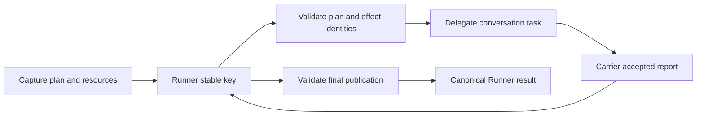

# Runner workflow effects

Runner owns DAG scheduling, durable job admission and canonical results. Orchestration registers an immutable conversation plan, captures resources before admission and implements its effects through delegated tasks. The persistent effect socket is `execution-workflows.sock`; submitting without that running host fails with `host_required`.

| Phase | Validation / retained state |
| --- | --- |
| Admission | Existing absolute workspace; supported exact environment; 1–16 steps; unique bounded ASCII IDs; valid dependencies and no cycles |
| Plan | `aixand.chat-workflow` version 2; compatibility `profile` stores environment ID; delivery step defaults to last declared step |
| Runner capability | Health must advertise native chat workflows version 2 before submit |
| Identity | `runner_key=orchestration:{workflow_id}`; one recorded Runner job; exact plan/step equality |
| Start effect | Inputs must exactly match declared dependencies and accepted successful reports |
| Step dispatch | `workflow-step:{job_id}:{step_id}` operation key; persist task association even for unconfirmed startup |
| Publish | Every successful step confirmed; all steps present on success; body equals delivery step's accepted report; conflicting publication rejected |
| Cancel / resume | Cancel exact key including admission races; resume same observed job; never replace it |

Dependency reports are appended as explicitly labeled evidence, not instructions. Combined conversation input must fit 32,000 characters. Serialized task result handoff above 32,000 bytes returns uncertain rather than truncating. Cancelled tasks map to failed workflow dependencies; `awaiting_report` maps to waiting, and unconfirmed/needs-input starts map to uncertain.

`inspect_execution_workflow` returns retained metadata plus Runner lookup. `get_execution_workflow_result` reads Runner's canonical result and refuses unconfirmed admission. A lost submit reply is inspected using the same workflow/key; repeated submission intent does not dispatch again. Failed publication can omit unstarted steps but cannot invent completed results.

The effect endpoint uses private local socket access and checks registered identities; frames are capped at 1 MiB, receive timeout is 25 seconds and concurrent effect connections are bounded. It is not an HTTP service. Automatic inbox delivery and parent-turn injection remain application policies, separate from retaining the workflow result.

[workflows.py](../../src/orchestration_mcp/workflows.py), [workflow schemas](../../src/orchestration_mcp/tool_groups/workflows.py), [Runner integration tests](../../tests/test_execution_workflows.py), [retained setup commands](../delegation-workflows.md#run-a-conversation-dag).
