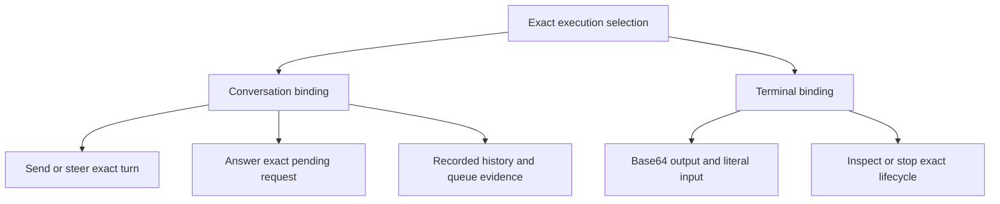

# Conversation and terminal lifecycles

Structured conversation operations use Conversation Manager. Native terminal operations use Agent Manager with Undercurrent. They have separate references and contracts: terminal input cannot substitute for a conversation message, and a process exit cannot substitute for a turn or task result.



| Concern | Conversation | Terminal |
| --- | --- | --- |
| Start target | Provider `codex`/`opencode`, immutable environment, exactly one of `cwd` or application-resolved `project_id` | Provider, profile resolved once, absolute `cwd`, optional expected environment |
| Input | New turn via send; steer requires `expected_turn_id` | Literal text, explicit submit behavior; optional expected revision |
| Observation | Events, state, capabilities, history and exact `turn_id` result | Lifecycle and raw bytes, not parsed provider output |
| Stop | Cancel exact turn or explicitly close supported conversation | Stop exact execution, optional force/revision |
| Background | Verified descendant agent history and owned process output/stop | Native execution observation |
| Offline reads | Manager history, canonical turn result, recorded queue and delivery evidence | Runtime retention determines available bytes |

`read_terminal_output` returns `from_offset`, `next_offset`, producer head, `has_more`, base64 data and `gap`. A retention gap reports `available_from` and requires an explicit next offset; it does not silently skip output. `max_bytes` is capped at 65,536.

## Queue and recovery boundaries

Queue modes are `after_turn` and `next_tool_completion`, both with an expected turn ID. Edit/remove/pause/resume/reconcile go through Conversation Manager; edits can use its expected revision. Recorded queue inspection and delivery evidence do not require a live worker. Slash commands and settings are advertised by the connected adapter; unsupported mappings must not fall back to guessed text input.

`reconnect_conversation` inspects the recorded runtime owner first. It resumes only after that exact owner is confirmed stopped/exited/failed. An active separate server is preserved. A closed shared worker can be terminated and rechecked before resuming that saved conversation. Unknown or changed owners block recovery.

[execution dispatch and reconnect](../../src/orchestration_mcp/executions.py), [conversation schemas](../../src/orchestration_mcp/tool_groups/conversations.py), [queue schemas](../../src/orchestration_mcp/tool_groups/queues.py), [terminal schemas](../../src/orchestration_mcp/tool_groups/terminals.py).

Checks: [execution behavior](../../tests/test_execution_groups.py), [shared Codex recovery](../../tests/test_codex_server_settings.py).

## Start then send

`start_conversation` creates a conversation without sending an initial message.
Supply exactly one of `cwd` or application-resolved `project_id`. The following
are tool argument examples, not commands to run before selecting an advertised
provider and exact environment. Replace the placeholders and retain each key:

```json
{
  "provider": "codex",
  "environment_id": "selected-environment-id",
  "cwd": "/absolute/project",
  "operation_id": "start-conversation-1"
}
```

Inspect the startup receipt and retain its conversation ID, then call
`send_conversation_message` with a separate mutation identity:

```json
{
  "conversation_id": "retained-conversation-id",
  "text": "Inspect this project and describe its entrypoints.",
  "operation_id": "send-message-1"
}
```

For a project target, replace `cwd` with `project_id`; do not supply both.
Project resolution requires the [injected application adapter](../reference/tool-groups.md#project-schema-contract).
Inspect uncertain startup before sending or starting another conversation.
