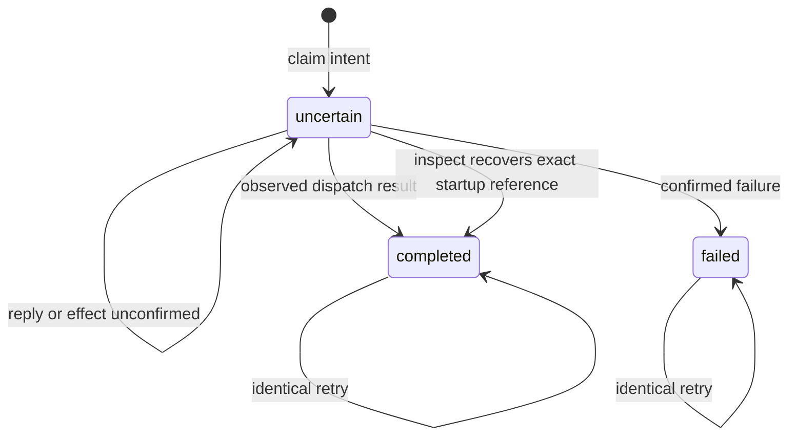

# Durable receipts and uncertain effects

Every tool built with the mutation schema requires a stable `operation_id`. ExecutionServices stores canonical `[tool, arguments]` intent before dispatch, derives the SDK child UUID from the resolved home and key, and returns retained state on a repeated identical call. Reusing the key for different arguments conflicts. Transport request IDs are separate; profile-management calls derive their own UUID from home, backend instance and request identity.

| Observation | Meaning | Next action |
| --- | --- | --- |
| `completed` receipt | Tool dispatch returned a retained result | Inspect nested result; this is not task correctness |
| `failed` / `unsupported` | Tool or SDK returned a confirmed negative result | Fix the cause; preserve the original receipt |
| `uncertain` | Dispatch may have occurred | Call `inspect_execution_operation` with the same key |
| Missing SDK evidence | Owner unavailable or observation failed | Keep identity; reconnect and inspect later |
| Conflicting key | Tool or arguments differ from retained intent | Recover the original intent before further effects |

Inspection consults recorded tasks/workflows, Conversation Manager operation receipts or the exact native child key. When a previously uncertain conversation/terminal startup yields a reference, it repairs the saved binding and receipt. This narrow reconciliation does not authorize repeating arbitrary writes or resubmitting a workflow.

Remote host requests mark effects uncertain after submission if the response cannot be confirmed. Host response loss does not remove its receipt. The execution lock serializes mutations; selected background reads release it before provider inspection so polling does not stall mutations.

[claim, finish and execute](../../src/orchestration_mcp/executions.py), [remote request handling](../../src/orchestration_mcp/broker.py), [public error shape](../../src/orchestration_mcp/errors.py).

Checks: [unknown startup and failed SDK receipts](../../tests/test_execution_groups.py), [lost Runner submission](../../tests/test_execution_workflows.py), [profile request identity](../../tests/test_profiles.py).
