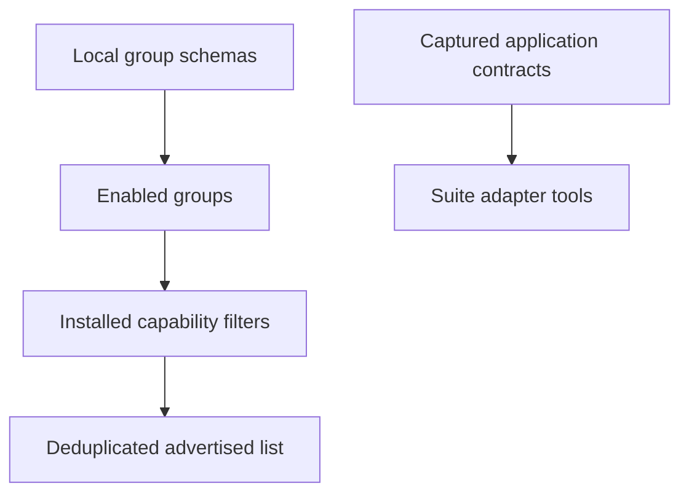

# Tool registration and contract families

The source contains two related contract families: SDK-free local execution groups, and captured application contracts loaded by `catalog`. They do not imply the same runtime services. Only the connection's advertised tool list is callable.



| Local group | Tools / behavior | Gate |
| --- | --- | --- |
| `shared`, `observations` | `list_execution_agents`, `list_orchestration_executions`, `inspect_execution_operation`; shared is an alias | Agent discovery requires Agent Manager |
| `agents` | Management catalog from Agent Manager | Agent Manager and jsonschema; login tools additionally need terminal capability |
| `conversations` | Start/inspect, send/steer/cancel, history/events/results, settings/commands/requests, background activity, close | Conversation Manager |
| `queues` | Queue, inspect, change and delivery inspection | Conversations group and integration |
| `terminals` | Start/inspect/read/write/stop native execution | Agent Manager and Undercurrent |
| `tasks` | Delegate conversation/terminal task; list/get/cancel/events | Delegation needs selected mode plus Carrier; reads remain mode-filtered |
| `workflows` | Submit/inspect/result/cancel/resume conversation workflow | Runner, conversations, Carrier configuration and conversations group |
| `resources` | `resource_catalog` | At least one resource manager |
| `projects` | List/get/register/create project | Explicitly injected application project operations |

Default CLI groups are `shared,agents,conversations,terminals,queues,tasks,resources`; workflows/projects require explicit selection. Capabilities report installed integration modules and configuration, not service health or provider authentication. Base imports defer optional SDKs; a broken installed integration reports `integration_broken`, distinct from `integration_missing`.

Tool schemas reject unknown fields, enforce required values and primitive/collection bounds. Mutations add required `operation_id`; IDs are bounded strings rather than automatically UUID-validated local schema fields. Semantic checks such as exact workspace, graph cycles and mode ownership occur in services.

## Captured application contracts

`catalog.load` accepts only `aixand_workspace`, `aixand_agents` and `aixand_conversations`. Workspace augments its retained JSON with autonomous monitor and command-workflow contracts. Agent tools can be replaced by the installed Agent Manager management contract. `native` exports namespace/function shapes; stdio uses the same canonical tool data. These schemas are integration contracts, not a standalone monitor service.

`workflow_contract.py` retains the application-owned final-JSON/read-input protocol. It differs from standalone delegated Carrier submission. `workflow_protocol.py` retains application Runner capability checks, including permissions and resource policies; the current standalone effect host uses `runner_client` instead.

[execution_tools.py](../../src/orchestration_mcp/execution_tools.py), [tool schema helpers](../../src/orchestration_mcp/tool_groups/common.py), [project schemas](../../src/orchestration_mcp/tool_groups/projects.py), [backend registration](../../src/orchestration_mcp/backend.py), [catalog.py](../../src/orchestration_mcp/catalog.py), [automation contracts](../../src/orchestration_mcp/automation_contract.py), [workflow contract](../../src/orchestration_mcp/workflow_contract.py), [application Runner protocol](../../src/orchestration_mcp/workflow_protocol.py).

## Optional installation extras

Select only the dependencies needed for the advertised groups. Package metadata
is the authoritative dependency list; installing an extra does not start daemons,
install a provider binary, copy credentials or pair a device.

| Extra | Dependency purpose |
| --- | --- |
| `agents` | Agent Manager and JSON Schema validation |
| `resources` | MCP, Prompt and Skill Manager clients; capture limits still apply |
| `conversations` | Conversation Manager with agent support |
| `terminals` | Agent Manager with Undercurrent support |
| `runtime` | Conversation and terminal dependencies together |
| `tasks` / `carrier` | Carrier client |
| `workflows` | Conversation Manager, Runner client and Carrier |
| `runner` | Runner client only |
| `connect` | Connect dependency; does not establish standalone device tools |

Install `[conversations,tasks]` for conversation delegation or `[terminals,tasks]`
for finite native delegation. Plain conversations and terminals do not require
Carrier. Workflow setup needs the `[workflows]` extra and a separately provisioned
Runner/Carrier service; see [the setup recipe](../delegation-workflows.md#run-a-conversation-dag).
See [package metadata](../../pyproject.toml) and [resource limits](../integrations/resources.md).

## CLI configuration and retry identity

| Option | Selection |
| --- | --- |
| `--home` / `ORCHESTRATION_HOME` | Independent orchestration state home |
| `--manager-home`, `--config` | Agent Manager location and configuration |
| `--runtime-home` | Native runtime home |
| `--runner-home` | Runner home |
| `--provider`, `--profile` | Local execution selection inputs; structured conversation startup requires an exact environment ID |
| `--groups` | Comma-separated groups, frozen for an initialized MCP connection |
| `--suite off` | Independent routing |
| `--suite auto` | Use configured `--suite-context` / `ORCHESTRATION_SUITE_CONTEXT`, otherwise independent routing |
| `--suite required` | Require the application's private captured context |
| `--connection` | Private standalone host descriptor |
| `--arguments` | JSON tool arguments |
| `--request-id` | CLI transport/request identity; does not replace execution mutation `operation_id` |

A home is not a Suite workspace database. Keep routing fixed after an uncertain
response; never retry against a different home or backend. See
[composition](../architecture/composition.md) and [receipts](../lifecycles/receipts.md).

For example, a conversation mutation includes `operation_id` inside its arguments
(invoke only after inspecting advertised tools and replacing all placeholders):

```sh
orchestration-mcp call send_conversation_message --suite off \
  --home /absolute/orchestration --request-id send-request-1 \
  --arguments '{"conversation_id":"retained-conversation-id","text":"Inspect the project","operation_id":"send-operation-1"}'
```

After an uncertain response, inspect `send-operation-1` with
`inspect_execution_operation`. Preserve the original arguments and operation key;
do not create replacement work. Request IDs alone do not identify execution intent.

For persistent work, run one foreground host:

```sh
orchestration-mcp host --home ~/.local/state/aixand/orchestration --suite off
```

Clients using that home discover its private `connection.json`; disconnecting a
client leaves host-owned work running. Embedded `serve` jobs end with the process.
For Runner, use `execution-workflows.sock`, as shown in the canonical setup recipe.

For a source checkout, install from the Suite root before inspecting capabilities:

```sh
python -m pip install ./mcps/orchestration
orchestration-mcp capabilities --suite off
orchestration-mcp serve --suite off
```

For explicit Carrier configuration, start the host first, then Runner in a second
terminal with the same exported settings. This is the same setup as the
[workflow guide](../delegation-workflows.md#run-a-conversation-dag); Carrier must
already be provisioned and running with compatible optional dependencies.

```sh
export CARRIER_DATABASE=/absolute/carrier.db
export CARRIER_URL=http://127.0.0.1:8765
orchestration-mcp host --home /absolute/orchestration --suite off \
  --groups shared,conversations,queues,tasks,workflows --runner-home /absolute/runner
runner --home /absolute/runner serve \
  --effect-host /absolute/orchestration/execution-workflows.sock
```

For a source checkout, install from the Suite root before inspecting capabilities:

```sh
python -m pip install ./mcps/orchestration
orchestration-mcp capabilities --suite off
orchestration-mcp serve --suite off
```

## Project schema contract

The `projects` group requires injected application project operations. There is no
standalone registry, and installing the package does not make `add_project`
available locally. Check the connected application's advertised tools first.

| Tool | Schema-level contract |
| --- | --- |
| `list_projects` | Optional query (up to 512 characters), offset and limit (1–200); directory availability is reported |
| `get_project` | Required stable `project_id` |
| `register_project` | Existing local directory `path`; no scaffolding or Git initialization |
| `create_project` | One new final directory under an existing parent; existing destinations use registration |

Both mutations require `operation_id` and accept optional `name` (1–128
characters). The schemas do not promise name defaulting, alias resolution,
retained-directory recovery or ownership of an ambiguous mkdir. Those semantics
must be verified in the injecting application. Inspect operations through
`inspect_execution_operation` when supported by that adapter; never infer success
from a directory's existence. See [project schemas](../../src/orchestration_mcp/tool_groups/projects.py)
and [injection boundary](../../src/orchestration_mcp/backend.py).
