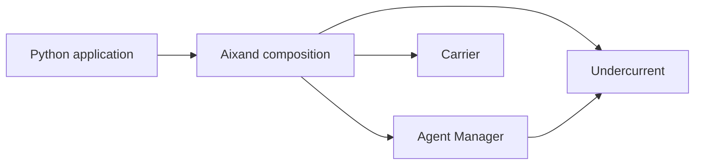

# Understand Aixand Python SDK

Aixand Python composes native agent launch, runtime interaction, and durable messaging for a Python application. Install `aixand-suite-python`; import `aixand`. Agent Manager owns managed runs, Undercurrent owns runtime sessions, and Carrier owns message storage. This SDK owns the local handles, resource scope, and delivery consumers joining those services.

It is independent of the Suite desktop and Server. It is not the [Runner client](../../../workflow/runner/python/README.md), a workflow engine, or a Python-to-IR compiler. A running terminal or an accepted prompt does not establish a successful application result.

## Reading paths

| Goal | Read |
| --- | --- |
| Understand dependencies and ownership | [Composition](architecture/composition.md), [identity and ownership](architecture/ownership.md) |
| Change input or cancellation | [Agent lifecycle](lifecycles/agent-lifecycle.md), [cleanup](lifecycles/cleanup.md) |
| Change message delivery | [Carrier integration](integrations/carrier.md), [recovery and errors](lifecycles/recovery.md) |
| Configure a provider or resources | [Native launch boundary](integrations/native-launch.md) |
| Find implementation and tests | [Development](development/verification.md), [API map](reference/api.md) |
| Assess missing support | [Implementation status](reference/implementation-status.md) |

Start with [setup](development/verification.md#setup-and-exact-existing-commands), the [first direct agent](lifecycles/agent-lifecycle.md#first-direct-agent), or [runnable examples](development/verification.md#examples-are-different-evidence). The [package README](../README.md) retains stable forwarding anchors.

## Evidence levels

| Evidence | Establishes | Does not establish |
| --- | --- | --- |
| `InputReceipt` | Runtime input submission receipt | Agent accepted or completed task |
| `accepted:<token>` from bound identity | Explicit prompt acceptance | Correctness or completion |
| `Agent.wait()` | Stable running/available/clear observation | Application success |
| Correlated Carrier final reply | Application protocol response | Result validity without application checks |

Source: [exports](../src/aixand/__init__.py), [composition tests](../tests/test_composition.py).
