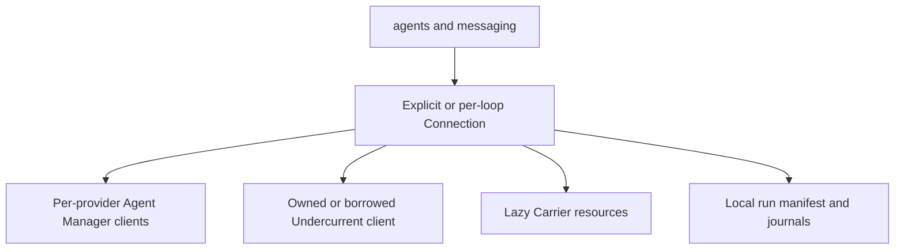

# SDK composition

The canonical API is the `agents` and `messaging` modules. An explicit `Connection` is an optional shared lifetime/configuration scope; `connection.agents` is a tuple of handles, not a manager facade. Omitted `connection=` resolves a lazy default attached to the current event loop. `connect()` does not install an ambient default.



## Explicit connection example

The following fragment runs inside an async function after `import aixand` and [profile/runtime setup](../development/verification.md#setup-and-exact-existing-commands). Pass the scope explicitly; `connect()` does not change the default.

```python
async with aixand.connect(
    runtime_home="~/.aixand/undercurrent",
    stable_for=2,
    timeout=300,
    stop_on_exit=True,
) as connection:
    agent = await aixand.agents.spawn(
        provider="codex", profile="research", connection=connection,
    )
    await agent.send("Research this project.")
    await agent.wait()
```

Connection options include `runtime_home`, `bridge`, `manager_config`, `manager_home`, `state_dir`, `stable_for`, `timeout`, `carrier`, `stop_on_exit`, `labels`, and `metadata`. Borrow an existing `undercurrent.Client` with `runtime=` instead of `runtime_home`/`bridge`; the SDK never closes a borrowed runtime. See [cleanup](../lifecycles/cleanup.md) for detach and stop policies.

## Components

| Implementation | Responsibility | Boundary |
| --- | --- | --- |
| [agents.py](../../src/aixand/agents.py) | Spawn, attach, restore, profile and budget queries | Delegates launch to Agent Manager |
| [_agent.py](../../src/aixand/_agent.py) | Handle identity, serialized input, readiness, stop | Returns native runtime observations/receipts |
| [_connection.py](../../src/aixand/_connection.py) | Client caches, scope ownership, failure supervision, manifest | Does not supervise durable workflows |
| [_carrier.py](../../src/aixand/_carrier.py) | Carrier provisioning, native clients, optional private subprocess | Uses public SDK/CLI, not Carrier store access |
| [_binding.py](../../src/aixand/_binding.py) | One managed consumer and delivery journal per bound handle | Does not extract answers from terminal screens |
| [messaging.py](../../src/aixand/messaging.py) | Ordinary application mailbox access | Returns a native Carrier client |
| [_config.py](../../src/aixand/_config.py) | Carrier mode and finite duration validation | Does not validate provider credentials |

Importing starts no process or connection. `open()` creates a run directory and initial manifest. `manager(provider)` constructs a lazy runtime client if needed and caches one manager per provider, but profile queries need not connect the runtime. `runtime()` calls the runtime client's `connect()`. Plain spawn without `address=` does not start or contact Carrier.

## Context composition

`Connection.with_context()` returns a view with resolved labels/metadata and its own manager views. It shares the parent's runtime, registries, mutation lock, Carrier resources, and directory. Closing a view is a no-op. Nested view inheritance flags are combined; per-launch overrides resolve through Agent Manager's `Context`. The root connection remains the lifetime owner.

Labels are copied onto handles; `Agent.metadata()` explicitly queries the manager. Invalid context is validated before provisioning. See [context tests](../../tests/test_composition.py) (`test_scoped_context_forwards_maps_and_keeps_owner_lifetime`, `test_invalid_context_is_rejected_before_carrier_provisioning`) and the preserved [external metadata contract](https://github.com/Aixand/manager-suite/blob/main/agent-manager/docs/python-sdk.md#labels-and-private-metadata).

### Inherited context example

Inside an async function after `import aixand` and native setup:

```python
async with aixand.connect(labels={"app": "project-x"}, metadata={"inputs.path": "/work/inputs.json"}) as connection:
    workflow = connection.with_context(labels={"workflow.run_id": "run-42"})
    agent = await aixand.agents.spawn(connection=workflow, labels={"role": "reviewer"})
    print(agent.labels)
    private = await agent.metadata()
```

Launch overrides win over inherited defaults. `with_context` and `agents.spawn` accept independent `inherit_labels=False` and `inherit_metadata=False`. Both maps contain strings; metadata is read explicitly and omitted from handles and list views.

## Dependency contract

[pyproject.toml](../../pyproject.toml) requires Python 3.11+, filesystem locking, Agent Manager SDK, Undercurrent SDK, Carrier MCP, and OpenTelemetry API. The distribution/import names differ: `aixand-agent-manager`/`agent_manager`, `aixand-undercurrent-sdk`/`undercurrent`, `aixand-carrier-mcp`/`carrier`. Provider executables, authenticated profiles, daemon startup, and compatible bridge binaries remain installation responsibilities.
