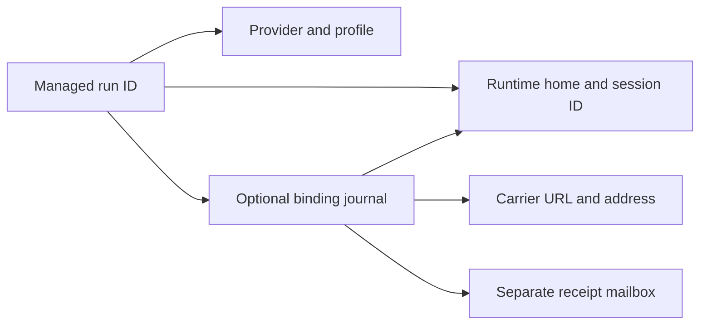

# Identity and ownership

An `Agent` is a composition handle around an Agent Manager record. A profile can launch several conversations; it is not the conversation identity. Runtime and Carrier coordinates must remain tied to the original run when restoring delivery.

## Identity contracts

| Identifier | Owner and use | Must not substitute |
| --- | --- | --- |
| `run_id` | Manager record; key of connection handle cache | Profile name or runtime session ID |
| `provider`, `profile`, managed `home` | Manager launch environment | A new conversation with identical profile |
| `session_id`, runtime `home` | Undercurrent execution target | Another runtime with similar sessions |
| `runtime_started_at` | Observed process start time captured after bound bootstrap | A replacement process using old coordinates |
| Carrier URL/address | Service and authenticated conversation inbox | A shared identity across conversations |
| Receipt address | Separate private acceptance inbox | Application result mailbox |
| `delivery_id` | Runtime input retry/delivery identity | Numeric Carrier message ID |
| Carrier numeric message ID | Receive/ack/reply correlation | Sender-chosen retry key |

`runtime_home`/`bridge` select a native Undercurrent installation. `runtime=` borrows an existing client and cannot be combined with those options. There is no Server selected-host routing in this SDK: the manager and runtime configuration must refer to the intended execution environment. `cwd`, `args`, `env`, and native configuration go to the provider launch through the manager.

## Resource ownership

| Resource | Owner | Close behavior |
| --- | --- | --- |
| SDK-created runtime client | Root connection | Close bridge/client; process stop is separate |
| Borrowed runtime client | Caller | Never closed by connection |
| Manager clients | Root connection | Close cached clients |
| Spawned agent session | Recorded in `_owned` | Stop only when requested on close |
| Attached handle from `get()` | External run owner | Close detaches; explicit `agent.stop()` can stop it |
| Bound inbox/receipt consumer | Binding under connection | Cancel and join, release journal lock |
| Ordinary mailbox consumer task | Application | Application must cancel/join its task |
| Private Carrier service | Connection | Terminate, then kill after five-second wait if needed |
| External Carrier service | External operator | Never stopped |

`get()` returns the cached handle for the same run/provider, preserving the input lock; it does not reconstruct a Carrier binding. Locks are local to a handle/connection except the binding journal's OS lock. Independent scopes and external runtime writers are not serialized by the SDK; runtime revision preconditions remain necessary.

Source: [connection](../../src/aixand/_connection.py), [get/restore](../../src/aixand/agents.py). Tests: [ownership and receipt cases](../../tests/test_composition.py), [isolated runtime cases](../../tests/test_integration.py).
