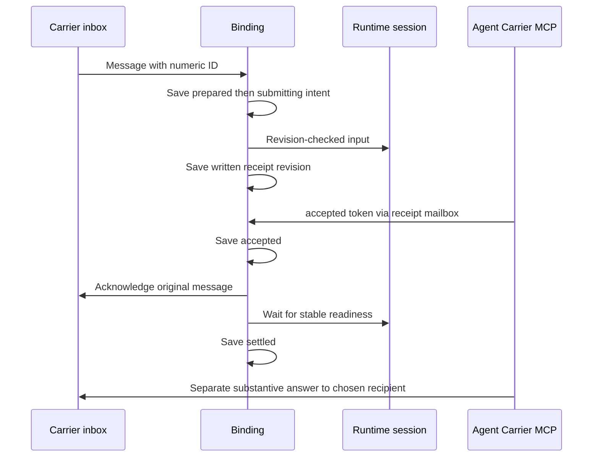

# Carrier delivery integration

`messaging.mailbox()` opens an ordinary native Carrier client for application messages, coordinators, or services. `spawn(address=...)` instead claims an inbox and a separate receipt inbox for one managed conversation. The application cannot open that claimed address through the same scope. This reservation is local; it does not authorize another process to become a second reader.



## Journal states

| State | Durable meaning | Redelivery behavior |
| --- | --- | --- |
| `prepared` | Full prompt/token saved before write | Check readiness, mark submitting, write |
| `submitting` | Write may have occurred | Refuse replay with `DeliveryUncertain` |
| `written` | Runtime receipt revision saved | Wait for acceptance without writing again |
| `accepted` | Matching authenticated receipt seen | Retry acknowledgment, then readiness; no reinjection |
| `settled` | Original ack and stable readiness completed | Ack without new input |

The SQLite journal keys deliveries by numeric Carrier message ID. Saved prompt content must still equal the received envelope. Its OS lock prevents concurrent owners of the same journal. This is conservative recovery evidence, not an exactly-once task execution guarantee.

Acceptance requires both `receipt.sender == bound address` and exact `accepted:<token>` content. The receipt is acknowledged independently. Polling starts at zero, advances through pages, and sleeps 0.25 seconds on empty pages. A timeout raises `AcceptanceTimeout` without replay. Incoming envelopes carry `kind`, `sender`, `message_id`, `reply_to`, and `content` as JSON before protocol text.

## Service configuration

| Mode | Startup and ownership |
| --- | --- |
| External default | URL `http://127.0.0.1:8765`; local administrative database defaults to `~/.aixand/carrier/carrier.db`; operator starts service |
| External with credentials | Native clients authenticate preprovisioned identities; URL must match intended service |
| Private | Lazy isolated database and loopback service under run directory; readiness probe; owned shutdown |

Auto-provisioning calls `python -m carrier.cli session ... --db ... --credentials ...`; the local database must be the one served at the configured URL. Remote service use needs supplied inbox and receipt credentials. The SDK never opens Carrier's database directly. Private startup uses a 20-second probe timeout; CLI subprocesses also have a 20-second budget.

The injected agent protocol prohibits receiving/waiting/acking from the agent and directs it to use MCP `send`. A new outgoing message gets a unique retry key; identical retries reuse it. Numeric received IDs are used as `reply_to`; asking a different peer is a new send. The agent must yield for replies. Python owns inbox delivery, while agents choose substantive answers.

Source: [_carrier.py](../../src/aixand/_carrier.py), [_binding.py](../../src/aixand/_binding.py), [messaging.py](../../src/aixand/messaging.py). Examples: [team](../../examples/team.py), [ordinary consumer integration](../../tests/test_integration.py). The team example uses native Python `idempotency_key="team-job"`; injected MCP instructions use the MCP tool's `message_id` field.

## Bound-agent illustration

Inside an async function after `import aixand`, with the `backup` profile authenticated (replace it with your actual profile):

```python
async with aixand.connect(
    carrier=aixand.CarrierConfig.private(), stop_on_exit=True,
) as connection:
    brain = await aixand.agents.spawn(
        provider="codex", profile="backup", address="brain",
        instructions="Advise Implementer. Reply through Carrier. Do not edit files.",
        connection=connection,
    )
    implementer = await aixand.agents.spawn(
        provider="codex", profile="backup", address="implementer",
        instructions="Consult brain when needed. Do not edit files.",
        connection=connection,
    )
    await implementer.send("Review this project and ask brain about one tradeoff.")
    await implementer.wait()
    # Runtime readiness may mean Implementer is waiting for Brain. Keep this scope
    # alive until your application protocol's completion condition is satisfied.
```

This illustrates launch and addressing, not a complete application completion protocol. Keep the scope alive until an explicit final response; [team.py](../../examples/team.py) implements correlated final replies, sender checking, acknowledgment and cleanup.

## Start an external service

Start the default external service yourself:

```sh
carrier serve
```

For another local service, pass `carrier=aixand.CarrierConfig(url="http://127.0.0.1:9000", database="/path/to/carrier.db")` to `aixand.connect()`. The database must be the one served by that URL. For remote services supply preprovisioned `credentials=` to `messaging.mailbox`; bound spawn also requires distinct `receipt_credentials=` for fresh conversation identities.

## Ordinary application consumer

Inside an async function after `import aixand`, with an already open `connection` configured for the intended service:

```python
mailbox = await aixand.messaging.mailbox("processor", connection=connection)

@mailbox.consumer()
async def process(message):
    await message.reply(message.content.upper())
    await message.ack()

await mailbox.run()  # Your application owns this foreground consumer's lifetime.
```

The application owns this foreground consumer lifetime. A coordinator is another ordinary mailbox used to assign jobs and collect final results; it is optional. For managed-agent failure supervision, see [supervised reply waits](../lifecycles/cleanup.md#supervised-reply-wait).
