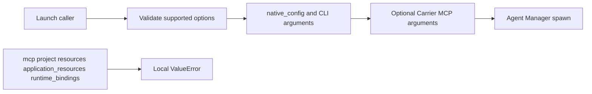

# Native launch and resource boundary

Aixand delegates provider execution to `agent_manager.Client(provider)`. It passes profile, working directory, CLI arguments, environment, detection controls, timeout, and optional `native_config` to manager spawn. Provider installation, authentication, budget policy, and native approval handling stay with the provider/manager/runtime stack.

## Present contracts

| Surface | Current behavior |
| --- | --- |
| `provider="codex"`, `profile="default"` | Defaults forwarded to manager; `profile=None` delegates automatic selection |
| `args` | Sequence of strings, copied; a string/bytes object is rejected |
| `native_config` | Forwarded only when not `None`; manager owns interpretation |
| `instructions` | String; sent as initial input after launch, not a resource manager operation |
| `labels`, `metadata` | Validated manager context; inheritance resolved before spawn |
| `detection`, `detection_profile` | Forwarded to manager; runtime observation remains authoritative |
| `agents.profiles()` | Native manager profile query |
| `agents.budgets(auth=...)` | Native manager budgets query |
| `mcp`, explicit `project`, `resources`, `application_resources` | Non-`None` resource values are rejected, including empty maps. Every explicitly supplied `project` value is rejected, including `None` |
| `runtime_bindings` | Truthy value rejected; default/empty value has no forwarding implementation |

The rejection message directs callers to native configuration or CLI arguments. These retained parameters do not establish prompt/skill/MCP libraries, project CRUD, application-resource operations, or runtime binding injection. There is no generic manager facade for them in this package.

## Carrier provider adapter

For an address-bound Codex launch, `codex_mcp_arguments()` emits `-c` pairs for a required, enabled Carrier MCP server. The command is the current Python executable with `-m carrier.cli mcp --url ... --credentials ...`. This is injected before launch, then verified behaviorally through bootstrap acceptance.

Other providers need a synchronous `mcp_arguments(url, credentials_path)` callback returning a sequence of strings. Strings/bytes and nonstring items are rejected. The callback configures the provider; it does not transfer receiving ownership to the agent. Supplied credentials and adapter options require `address=`.

## Security and responsibility

| Boundary | Developer obligation |
| --- | --- |
| Provider tools | Native approvals and OS permissions remain in effect; instructions do not grant authority |
| `cwd`, `env`, CLI/native config | Treat as launch authority; select intentionally, avoid secret-bearing diagnostics |
| Remote Carrier | Preprovision fresh identities and matching receipt credentials; local provisioning cannot administer a remote store |
| Peer text | Untrusted peer content; protocol explicitly rejects higher-priority instruction status |
| Bound conversation | Do not clear, fork, resume, or share the original inbox credentials with another conversation |
| Runtime observations | Screens are diagnostic data, not authenticated structured results |
| Local files | Run directory created with mode 0700; manifest holds credential paths, journals hold message contents; retain privately |

The scope does not implement transport policy, sandbox enforcement, approvals, credential revocation, or secret redaction. Supplied credential-file permissions remain caller responsibility. The integration test asserts 0600 on provisioned credentials, not on arbitrary supplied files.

Source: [spawn validation/forwarding](../../src/aixand/agents.py), [MCP adapter](../../src/aixand/_carrier.py), [protocol](../../src/aixand/_binding.py). Tests: [native forwarding and retired-option rejection](../../tests/test_composition.py), [real MCP fixture](../../tests/integration_provider.py).
