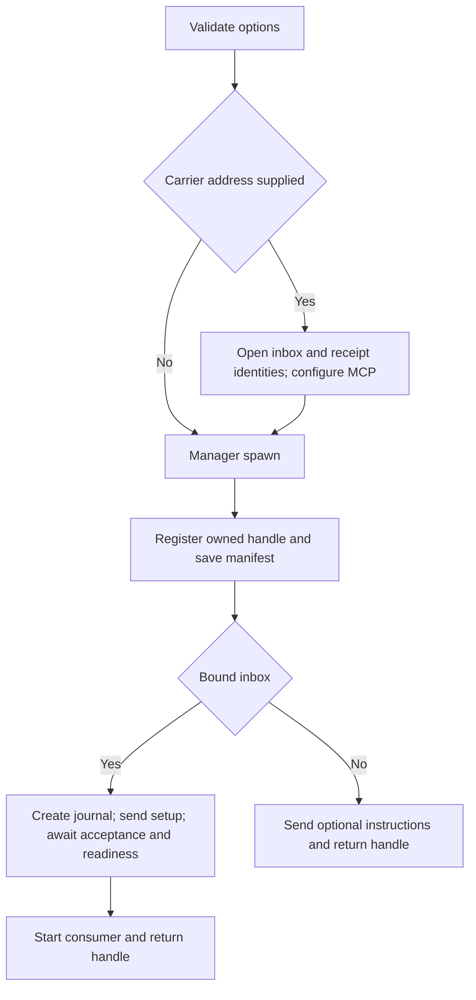

# Agent launch and input lifecycle

`agents.spawn()` validates configuration, resolves a scope, and serializes launch under its mutation lock. Agent Manager performs the launch. Once returned, the handle is registered and marked owned before optional bootstrap, so a failed setup can retain an inspectable live run.



For bound agents, setup includes the protocol and role instructions, asks for acceptance, and requires the agent to end its setup turn without starting work. A plain agent only sends nonempty instructions if supplied. A setup exception becomes `AgentSetupError(agent, cause)`; cancellation propagates with the known handle retained. A manager `LaunchError` is saved under `unconfirmed_launches` with the original run ID and is never retried here.

## Input admission

`Agent.send()` requires nonempty text, creates a tracked task, and applies its duration budget around lock acquisition, readiness, and submission. Direct sends and inbox delivery share `_input_lock`. Before any new input, the handle checks scope health, stopping/stopped state, uncertain input, prior pending acceptance, and runtime stability.

| Step | Contract |
| --- | --- |
| Readiness | `lifecycle="running"`, `interaction="available"`, `constraint="clear"`; default `stable_for=2.0`, `timeout=300.0` |
| Revision boundary | Admission follows latest delivery of either direct or Carrier input |
| Submit | `send_input(session_id, text, submit=True, expected_revision=ready.revision, delivery_id=token)` |
| Receipt | Native `InputReceipt` returned; stored boundaries change only when foreground revision exists |
| Bound direct prompt | JSON `aixand_input` envelope, protocol, and acceptance instruction |
| Next input | Wait for previous bound prompt's authenticated acceptance before checking readiness |

## Waiting and observations

| Call | Observation boundary |
| --- | --- |
| `wait()` | Latest successful direct send with a foreground revision; current readiness before first send |
| `wait(after=receipt)` | Explicit native receipt from this session, requiring a foreground revision |
| `wait(after=None)` | Current readiness with no delivery boundary |
| `inspect()` | Native session snapshot |
| `read_screen()` | Native terminal screen bytes; diagnostic only |

Carrier deliveries update input admission but do not retarget public `wait()` to a background turn. A deduplicated receipt without a revision preserves the previous boundary. Runtime readiness can mean the agent yielded while waiting for a peer. Require an application-defined response for completion.

Source: [spawn](../../src/aixand/agents.py), [Agent](../../src/aixand/_agent.py). Tests: [receipt defaults, concurrent sends, foreign receipts, setup failure](../../tests/test_composition.py).

## First direct agent

Prepare an authenticated profile using the [setup guide](../development/verification.md#setup-and-exact-existing-commands). Replace `research` with your profile or use `profile=None`. Run from a disposable project after starting the selected Undercurrent daemon; native approvals and provider quota may apply.

```python
import asyncio
import aixand

async def main():
    try:
        agent = await aixand.agents.spawn(
            provider="codex", profile="research", cwd=".",
        )
        receipt = await agent.send("Research this project without changing files.")
        await agent.wait(stable_for=2, timeout=300)

        await agent.send("Now summarize your findings.")
        await agent.wait()
        print((await agent.read_screen()).decode(errors="replace"))
    finally:
        await aixand.close(stop_agents=True)

asyncio.run(main())
```

`provider="codex"` selects the provider; Undercurrent is the runtime. The screen is diagnostic output. Neither submission nor stable readiness proves the research succeeded. On failure preserve the original session and receipts before launching again. The runnable [research example](../../examples/research.py) implements the same two-turn pattern. Use the [team example](../../examples/team.py) for an explicit Carrier completion response.
