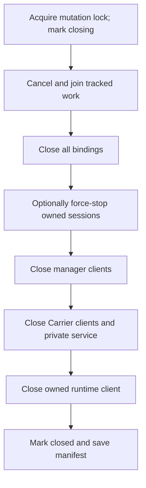

# Async scope and cleanup

A connection binds to its first running event loop and refuses cross-loop reuse. The module default is per loop; close it before `asyncio.run()` exits. Explicit scopes do not change that default: pass `connection=` consistently.



## Lifetime distinctions

| Action | Session effect | Scope effect |
| --- | --- | --- |
| `await connection.close()` | Detach by default | Close scope resources |
| `stop_on_exit=True` | Force-stop owned, not attached, sessions at close | Same cleanup sequence |
| `close(stop_agents=True/False)` | Explicitly overrides stop-on-exit policy | Same cleanup sequence |
| `await agent.stop(force=False)` | Cancel consumer and sends, then stop this session | Leaves scope and other agents alive |
| Cancel `agent.wait()` | Cancels/join supplied observation | Does not stop session |
| Cancel a send during write | May leave uncertain input | Retain evidence; do not infer rollback |
| Close a context view | No effect | Root remains owner |

`Agent.stop()` takes its stop lock, marks stopping, closes its binding, cancels and joins pending sends, then takes the input lock and delegates stop. It does not wait for a busy session to become input-ready. A successful stop sets `_stopped`; failed stop clears `_stopping` for explicit reconciliation.

Root `close()` is idempotent after closure. It attempts later cleanup stages even when earlier operations raise, marks closed and saves state in `finally`, then raises an `ExceptionGroup` for collected cleanup errors or the first managed consumer failure. During `async with`, an existing body exception receives a cleanup-failure note rather than being replaced.

`Connection.wait_for(awaitable, timeout=...)` races application work against the managed failure event. On success, failure, timeout, or cancellation it cancels and joins remaining tasks. Use it around Carrier reply waits so a dead managed consumer interrupts the application instead of leaving a silent pending wait. Ordinary application consumer tasks are not automatically enrolled; own their lifetime explicitly.

Implementation: [_connection.py](../../src/aixand/_connection.py), [_agent.py](../../src/aixand/_agent.py), [_binding.py](../../src/aixand/_binding.py). Checks: [cancellation and ownership tests](../../tests/test_composition.py), [two-loop and detach integration cases](../../tests/test_integration.py).

## Supervised reply wait

Inside an async function with an open `connection`, coordinator mailbox and a previously sent `job`:

```python
answer = await connection.wait_for(
    coordinator.wait_for_reply(job, timeout=600),
)
```

This interrupts the pending application wait if a managed consumer fails. See [team.py](../../examples/team.py) for job creation, reply sender validation and acknowledgment. It does not automatically supervise ordinary application consumer tasks.
