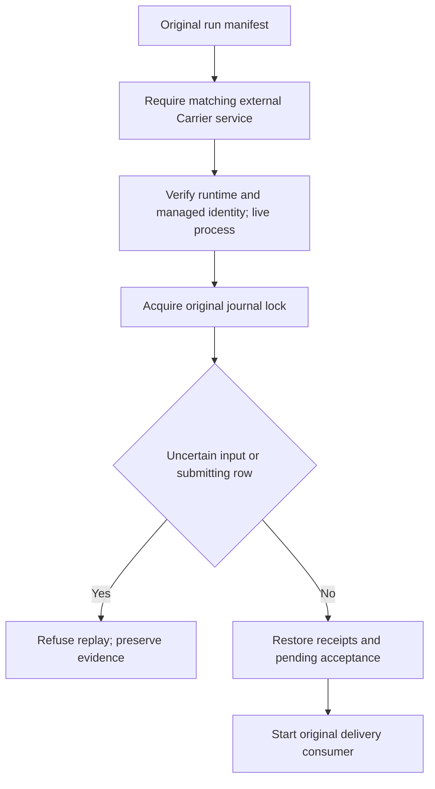

# Errors and recovery boundaries

The SDK does not retry failed mutations. Unknown input outcomes block later sends on the handle. Acceptance timeout means a write occurred but explicit acceptance was not confirmed; it is not evidence of absence or completion.

## Error contracts

| Failure | Evidence retained | Caller response |
| --- | --- | --- |
| `ValueError`/`TypeError` | Invalid local arguments | Correct configuration before retry |
| `ConnectionClosed` | Scope closing/closed | Use a deliberate new scope |
| `ConsumerError` | Address, session ID, original cause; scope error list/manifest | Inspect failure; pending managed work is interrupted |
| `AcceptanceTimeout` | Written prompt, token, pending acceptance | Inspect original conversation; no new write implied |
| `DeliveryUncertain` | Uncertain delivery ID or journal state | Reconcile original session; no public clear/reset API |
| `AgentSetupError` | `agent` handle and `cause` after known launch | Inspect or explicitly stop the existing agent |
| Manager `LaunchError` | Original run ID in `unconfirmed_launches` | Reconcile manager record before another launch |
| Underlying SDK errors | Original types propagate | Respect domain error and effect certainty |
| Cleanup `ExceptionGroup` | Collected cleanup exceptions | Inspect each failed cleanup operation |

`_write()` treats only an `UndercurrentError` with `effect_certainty="known_absent"` as definitely unwritten. Other exceptions, including cancellation during the write, save `_uncertain`. In journal delivery a known-absent runtime error returns the row to `prepared`; other failures leave `submitting`. No automatic write retry occurs in either case. A later explicit operation may proceed only when the relevant state permits it.

`inspect()` only reads the runtime snapshot; it does not clear uncertainty or unlock subsequent sends. There is no public uncertainty reset API. Preserve and reconcile the original evidence.

## Restore contract

`agents.get()` attaches a handle only. `agents.restore(run_id, manifest=..., connection=...)` recovers a managed consumer using the original manifest and journal; it never launches, resumes, forks, or replays an uncertain conversation.

| Check | Required evidence |
| --- | --- |
| Saved row | Address and binding present; no `uncertain_input` |
| Service | Both configurations external; matching normalized Carrier URL |
| Journal | Original file exists; binding identity matches; exclusive lock acquired |
| Runtime | Exact saved runtime home |
| Managed identity | Same run ID, provider, profile, managed home, session ID |
| Process | Running lifecycle; original start timestamp matches when saved |
| Receipts | Saved receipts belong to session; pending acceptance completed before consumer starts |
| Journal writes | No `submitting` rows |

A scope containing the run already must use a fresh recovery scope unless the same active consumer/address is already present, which is returned. Restoration reclaims saved credentials and copies saved ownership. As a consequence, a restored owned run can be stopped by `close(stop_agents=True)`; review that policy explicitly.

## Evidence files

`run.json` records status, runtime home, Carrier coordinates/credential paths, managed identities, ownership, binding journal paths, last direct/input receipts, pending acceptance, process start time, consumer errors, and unconfirmed launches. Writes use a temporary file, fsync, then replace. Tokens are in credential files, not embedded in the manifest. Journal prompts still contain message content and acceptance tokens. Preserve these private local artifacts for diagnosis; they are not a durable supervisor or portable replay plan.

Source: [restore](../../src/aixand/agents.py), [write certainty](../../src/aixand/_agent.py), [journal](../../src/aixand/_binding.py), [error classes](../../src/aixand/errors.py). [Composition tests](../../tests/test_composition.py) cover uncertain writes, canceled writes, ack redelivery, and authenticated acceptance. There is no dedicated restore test in the present test files; see [coverage gaps](../reference/implementation-status.md).
