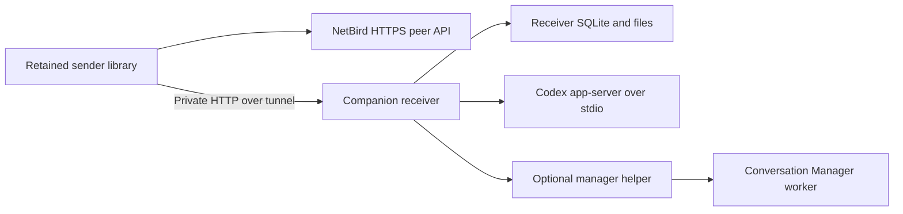

# Runtime and authority

The companion is a standard-library Python HTTP server with SQLite journals and optional local execution adapters. The retained sender is an embeddable asynchronous library: callers provide a SQLite connection, output callback and chat lookup. There is no standalone sender daemon here.

| Owner | State and execution authority | Boundary |
| --- | --- | --- |
| Sender `Connect` | NetBird credentials, paired-device identities, transfer intent, revisions | Injected database and event-loop writes; blocking network/hash work uses worker threads |
| Receiver `Receiver` | Token hashes, instance identity, receipts, publication | One process per state directory, reentrant database lock, full synchronous SQLite |
| `Server` / `Handler` | HTTP connection admission and dispatch | 12 request slots; excess connections close; 30-second connection timeout |
| `CodexSessions` / `Session` | Native processes, thread IDs, pending requests, bounded events | Four live sessions; only idle sessions without pending work may be evicted |
| `Managers` | Interpreter binding and helper subprocesses | Four helper slots, fixed bootstrap, no caller-supplied executable arguments |
| Conversation Manager | Retained managed worker and conversation | Helper disconnects after each call; it does not terminate retained work |

## Startup and shutdown

The CLI constructs private receive/state directories, locks the state directory, opens `receiver.sqlite3`, recovers transfer receipts, enables Codex only when project roots are supplied, and then binds the selected private IPv4 interface. Project workspaces require that Codex object. Manager discovery exists even when execution is disabled, but readiness is false without project roots.

Shutdown signals active transfers, closes the threaded server, closes direct Codex sessions and releases the database/process lock. A browser disconnect has no corresponding direct-session shutdown path. A companion shutdown does terminate its direct processes. Managed helper lifetime and worker lifetime differ.

Read [companion.py](../../aixand_connect/companion.py), [service.py](../../aixand_connect/service.py), then [Codex lifecycle](../integrations/direct-codex.md). The process-capacity and lock behavior is exercised by [test_connect.py](../../tests/test_connect.py) and [test_codex.py](../../tests/test_codex.py).
