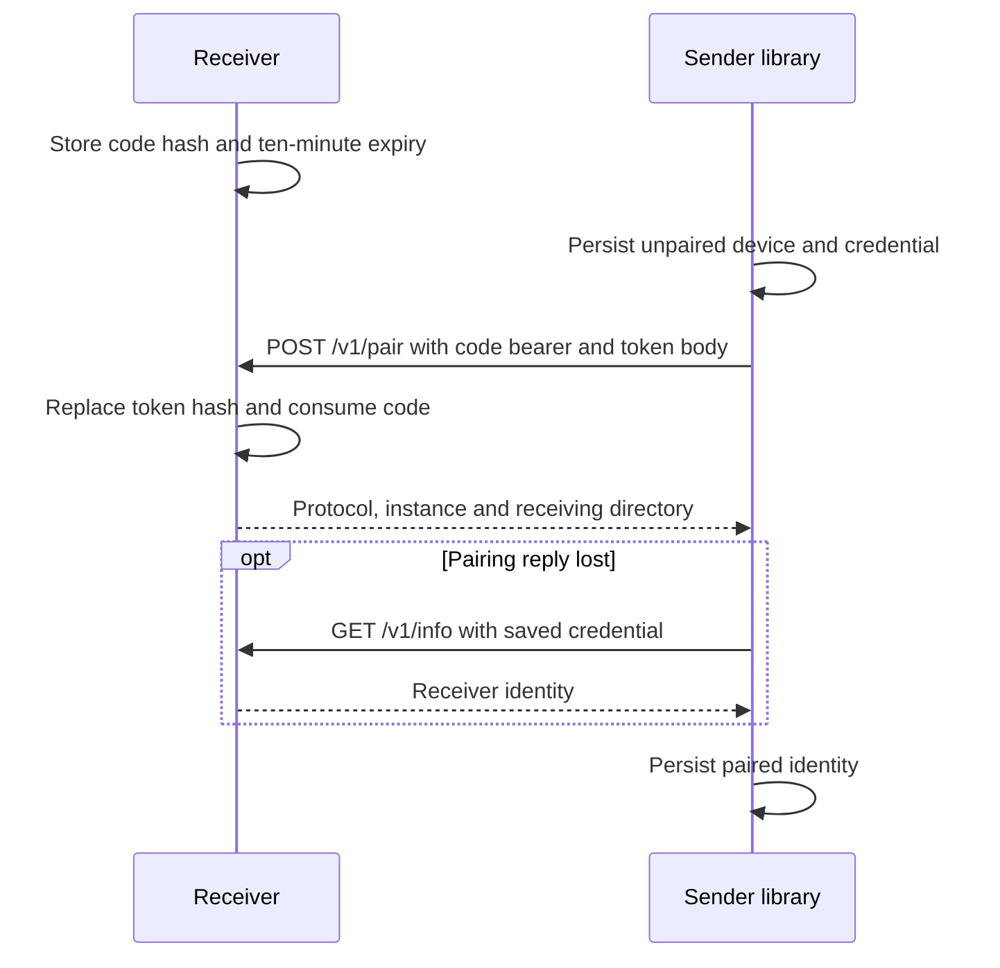

# Pairing and trust

Pairing binds one Suite credential to a persistent receiver instance and receiving directory. It is application authentication in addition to private-network access. HTTP has no TLS listener: confidentiality depends on the NetBird tunnel and its access policy.

| Contract | Implementation |
| --- | --- |
| Pairing secrets | `token_urlsafe(32)` code and distinct outbound credential; credential must match 43 URL-safe characters |
| Receiver storage | SHA-256 hashes only; constant-time digest comparison; successful pairing deletes code/expiry |
| Expiry and replacement | Ten minutes; code consumed once; pairing rejected during active file receives |
| Sender retry | Save before contact; same `pairKey` can reuse previous token; failed pairing can leave an unpaired device record |
| Identity pinning | Verify protocol 1, instance UUID, exact receiving directory and nonnegative integer `maxBytes` before sending/recovery |
| Device capacity | At most 16 paired registry entries; case-insensitive unique labels; address changes require pairing again |
| Forget | Removes outbound registry entry only; active/uncertain transfers block it; receiver credential revocation requires re-pairing |

## Network and filesystem constraints

[protocol.py](../../aixand_connect/protocol.py) accepts literal IPv4 only in `100.64.0.0/10`, RFC1918 ranges, or explicitly enabled test loopback. The production CLI does not enable loopback. This syntactic check cannot establish that an RFC1918 address actually belongs to NetBird; correct interface selection remains required. Wildcard, public and link-local binds fail.

Outbound requests use direct `http.client` connections without ambient proxies or redirect following. NetBird inventory uses HTTPS, `Authorization: Token`, an eight-second timeout, and only `/api/peers`. API URLs reject embedded credentials, query/fragment and other paths. Peer inventory does not prove companion reachability.

Sender `open_source` walks pinned directory descriptors with `O_NOFOLLOW`, rejects traversal and special files, and restricts sources to the saved chat project. Remote Codex directories resolve under explicitly configured roots; these roots are an application admission boundary, not a replacement for native sandbox/access settings. The paired owner can request the supported execution access modes.

State and staging directories reject direct symlink/junction paths. POSIX modes are private; Windows relies on user-specific ACLs. Sender secrets are plaintext in its injected SQLite database; backups therefore carry credentials. Receiver logs suppress headers and payloads.

See [service.py](../../aixand_connect/service.py), [companion.py](../../aixand_connect/companion.py), and authentication/path tests in [test_connect.py](../../tests/test_connect.py). Do not broaden arbitrary host, interpreter, environment or filesystem parameters through the Suite request schema.
