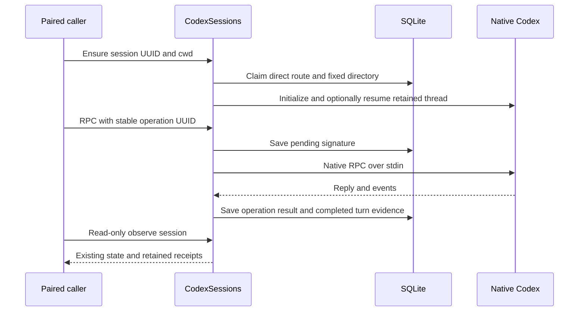

# Direct remote Codex sessions

Direct mode runs the receiving device's native `codex app-server --listen stdio://` in a validated existing directory. Provider login and filesystem access stay on the receiver. It does not require Agent Manager, Conversation Manager, Server Manager or an Undercurrent daemon.

| Contract | Behavior |
| --- | --- |
| Directory | Absolute or expanded `~/` path, accessible existing directory, resolves inside one configured project root; immutable per session |
| Route | Direct record and manager binding mutually exclude each other; no silent fallback |
| Native discovery | Explicit `--codex`, PATH, then common user/Homebrew/local locations; readiness runs version/login checks with eight-second timeouts |
| Process limit | Four live processes; evict oldest idle session only with no busy turn, approvals or pending native RPC |
| Read methods | `thread/read`, `model/list`; serialized without mutation journal |
| Mutations | `thread/start`, `thread/resume`, `turn/start`, `turn/steer`, `turn/interrupt`; fixed thread identity and method-specific field allowlists |
| Text inputs | 1–10 text entries, each at most 32000 characters; turn settings cannot inject arbitrary cwd/config |
| Access | Sandbox read-only/workspace-write/danger-full-access; approval on-request/never; persisted thread settings support resume |
| Timeout | Native acknowledgment waits 45 seconds; loss becomes uncertain; pending journal never repeats a mutation |

## Events, approvals and restart

Each live process has a generation UUID and increasing sequence. Long polling waits up to ten seconds, returns up to 64 events with an aggregate page bound, and marks `gap` if the cursor predates retained events. The deque retains at most 2048 events or 16 MiB. `bounded` trims history progressively, adds `historyTruncated`, and caps individual serialized results to one quarter of the shared 2 MiB limit.

Native request IDs are replaced with session-local UUIDs before exposure. `respond` maps back to the native ID and journals its answer key; repeated identical answers return the original receipt. Turn completion clears outstanding requests and saves bounded turn/items evidence to `codex_turns`.

Ensure can start a fresh app-server and resume the recorded native thread after process loss. GET session observation does not call ensure, start or resume; it can return retained `turnId`/`operationId` evidence with `running:false`. A missing recorded identity is an error. Browser loss does not stop a turn; companion closure terminates its direct subprocesses. Native Windows execution remains unverified.

Source: [codex.py](../../aixand_connect/codex.py), [HTTP dispatch](../../aixand_connect/companion.py). Evidence: [test_codex.py](../../tests/test_codex.py) uses [fake_codex.py](../../tests/fake_codex.py), exercising protocol behavior rather than a live provider. Current Suite orchestration gaps are listed in [status](../reference/status.md).
