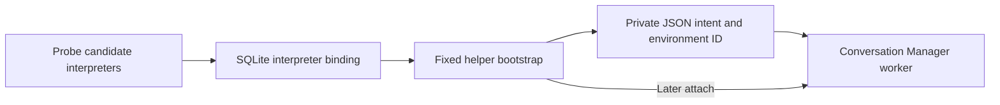

# Managed conversations and profile selection

Managed mode discovers compatible Agent Manager and Conversation Manager packages on the receiving device and invokes a fixed helper in that Python environment. Conversation Manager retains the worker; the short-lived helper only attaches, dispatches, observes and disconnects. Current code does not require Server Manager or Undercurrent for chat readiness.

## Discovery and immutable ownership

[managers.py](../../aixand_connect/managers.py) checks explicit `--manager-python`, or shebang interpreters from `agent`, `conversation-manager`, `mcp-manager`, `prompt-manager`, `skill-manager`, followed by the current Python (at most six candidates). Probe timeout is six seconds, inventory twelve, and operation calls normally 45. Inventory is cached for 30 seconds. Packages found in a different environment are marked `separateEnvironment`; their presence does not qualify the selected environment.

| Layer | Pinned identity |
| --- | --- |
| Companion | Session UUID → interpreter in `manager_bindings`; claim before helper dispatch |
| Helper JSON | `conversation-binding-1`, Agent Manager root/configuration, argument signature, profile policy, immutable environment ID/registry |
| Creation | `connect-create:{session UUID}` operation, settings/resource capture, then retained session/connection reference |
| Reattach | Existing session reference; missing worker raises rather than starting replacement |
| Mutation retry | Persist method/arguments in intents before dispatch; identical retry inspects SDK operation receipt; different arguments rejected |

## Selection and capabilities

| Input | Meaning |
| --- | --- |
| Omitted selection / `{mode:"auto"}` | Delegate to native `Manager.select_profile()` policy |
| `{mode:"specific",profile:"name"}` | Resolve exact profile to environment once; names follow the portable alphanumeric/underscore/hyphen rule |
| `{mode:"direct"}` | Explicit direct route; rejected by manager session API |
| Legacy `profile` create field | Converted to specific policy; exact argument allowlist still applies |
| `resources` | Optional explicit capture through `orchestration_mcp.resources.ResourceCapture`; cannot override access |

[profile_selection.py](../../aixand_connect/profile_selection.py) also accepts legacy `remoteProfile` through `from_args`, but rejects using both forms. Public selection exposes profile/auth/quota/reason/requested only; helper selection currently records `auth=None` and delegates readiness/selection to Agent Manager. Do not infer the older README's explicit quota-ranking algorithm from this helper.

Permission modes map to native settings: read-only → read-only/on-request; workspace-write → workspace-write/on-request; workspace-auto → workspace-write/never; full-access → danger-full-access/never. Later configuration is restricted to model, effort, serviceTier and mode. Commands must be advertised as native; permission-changing setting commands are marked unsupported. Approval responses at the HTTP facade require exactly `{native_result: ...}` and a pending request belonging to the session.

Read methods include state, capabilities, pending, history, events, operation, commands and configuration. Mutations are send, cancel, respond, command and set_config. The helper stores intent before delivery, so even an undispatched intent can remain uncertain without replay. State can adopt a completed creation receipt; operation inspection is restricted to IDs recorded for that chat. Helper exit calls `disconnect`, preserving worker ownership.

Read [manager_helper.py](../../aixand_connect/manager_helper.py), [test_managers.py](../../tests/test_managers.py), [test_managed_conversations.py](../../tests/test_managed_conversations.py) and [test_optional_resource_managers.py](../../tests/test_optional_resource_managers.py). Helper tests can exercise normalized SDK responses directly; that does not bypass the stricter companion HTTP approval shape in production. Managed conversations currently require POSIX; optional resource managers do not determine base chat readiness.
